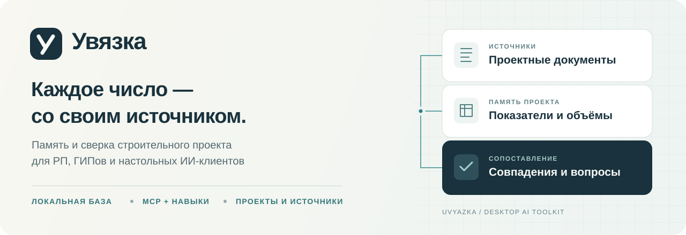

[](https://github.com/proovcme/uvyazka/actions/workflows/ci.yml)

[](LICENSE)


**Проверяемая память строительного проекта для РП, ГИПов и ИИ-ассистентов.**

Дайте Увязке папку проекта. Автоматика соберёт каталог документов, текст,
листы, таблицы и числовые кандидаты. Модель сможет читать эти данные и оригиналы,
сопоставлять разделы и сохранять результаты с источниками. Человек продолжит
ту же работу в локальной панели — и наоборот.

У каждого проекта своя SQLite-база. Повторное обращение использует сохранённые
данные; изменённые источники и зависимые выводы требуют перепроверки.
Модель работает в выбранном ИИ-клиенте через MCP. Обязательные API-ключи,
сервер генерации и векторная база для этого не нужны.

[Быстрый старт](#быстрый-старт-на-windows) · [Подключение MCP](#подключение-mcp) ·
[Панель](#панель) · [Веб-демо](https://locia.work/uvyazka/) · [Документация](#документация)

## В 0.4.0-alpha.4

Обновлён читатель RVT до **rvt-rs 0.11.0** с сохранением наших доработок
инженерных систем, материалов и происхождения параметров. Обновлены нативные
инструменты, WASM и версии кешей.

**Сохранение и экспорт → Экспорт IFC** выгружает всю прочитанную сцену или
видимые элементы в файл IFC4, с размещениями, ID и свойствами. Это
координационная геометрия; параметрические тела и непрочитанные части исходника
не восстанавливаются. Есть этапы обработки и отмена.

[Состав выпуска, проверка и ограничения](docs/RELEASE_0_4_0_ALPHA_4.md).

## Ранее: 0.4.0-alpha.3

Ускорены выбор элементов, поиск и обновление выделения в больших сценах.
Переносимые `.uvz` хранят повторяющиеся свойства совместно; обработку можно
отменить до применения результата. Исходные ID, параметры и геометрия сохраняются.

MCP и вьювер строят таблицы одним вычислительным движком: параметры, поддержанная
часть исходных спецификаций RVT и шаблон по ГОСТ. В настольную сборку включён
runtime таблиц. База результатов и источников общая для человека и ИИ-клиента.

[Состав выпуска, проверка и ограничения](docs/RELEASE_0_4_0_ALPHA_3.md).

## Ранее: 0.4.0-alpha.2

Обновлён настольный комплект: текущие читатели RVT/NWD/NWC, сборка смешанной
сцены, восстановление сеанса, спецификации и общий доступ к данным моделей
из панели, MCP и локального API. В обычных окнах — понятные статусы;
исходные ошибки и служебные поля доступны в свёрнутой диагностике.
Revit ID, IFC GlobalId, параметры и копирование исходных значений сохранены.

[Состав выпуска, проверка и ограничения](docs/RELEASE_0_4_0_ALPHA_2.md).

## Ранее: 0.4.0-alpha.1

**Проверки геометрии и настольная Увязка.** Составы A ↔ B, пересечения,
зазоры и заданные зоны обслуживания; история прогонов и решений, сохранённые
виды и шаблоны, экспорт BCF 2.1/3.0 и XLSX. Приближённая и непрочитанная
геометрия остаётся в охвате проверки и вопросах.

[Проверки и ограничения](docs/CLASHES.md) ·
[Установка Windows, MCP и обновления](docs/DESKTOP.md) ·
[Предварительный выпуск](https://github.com/proovcme/uvyazka/releases/tag/v0.4.0-alpha.3).

Настольная версия включает остальные инструменты Увязки и использует ту же
базу проекта. Публичное демо считает геометрию на устройстве и хранит результаты
в этом браузере; общей настольной SQLite у него нет.

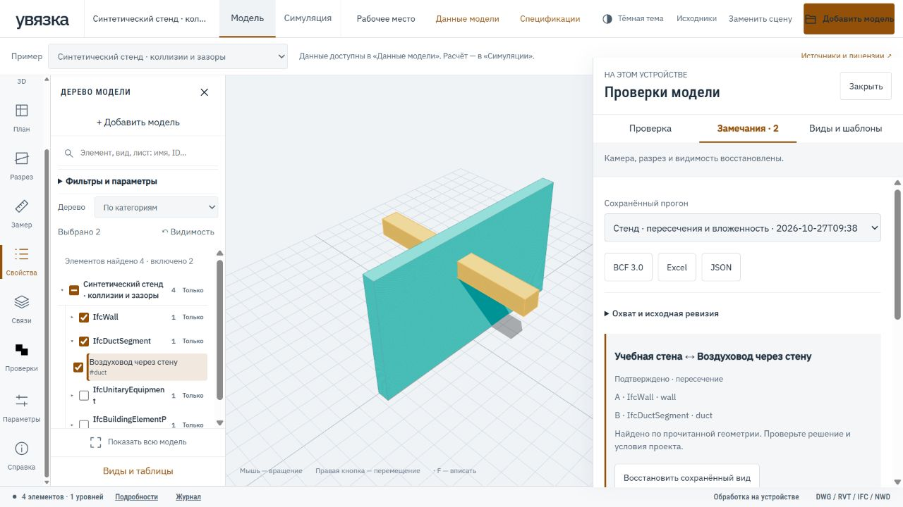

[Стенд с известными пересечениями и зазором](https://proovcme.github.io/uvyazka/?project=demo-a&example=803288beba6d19f07096f4f85896930e751ad963e9a7bbc767951848142f11f1)
→ **Проверки**. Размеры и решения этого примера вымышлены.

## Спецификации по ГОСТ

В свойствах и таблицах видны инженерные данные и копируемые исходные ID.
Служебные сообщения доступны в свёрнутой диагностике. Если спецификацию RVT
не удалось прочитать, окно прямо сообщает об этом и предлагает создать новую
таблицу по элементам. [Принципы интерфейса](docs/INTERFACE_LANGUAGE.md).
Это же правило действует в панели проекта: понятная ошибка с отдельной
диагностикой. Подписи категорий и условий переведены; исходные значения,
копирование, привязки шаблонов и выгрузки сохранены.

В конструкторе спецификаций появилась готовая форма оборудования по
ГОСТ 21.110-2013: выберите состав, назначьте источники через заголовки граф
и проверьте листы А3 перед выгрузкой PDF/XLSX. Ячейка показывает происхождение
значения, а непроверенные привязки и пропуски сохраняют статус черновика.
Существующие произвольные таблицы и сохранённые шаблоны продолжают работать.

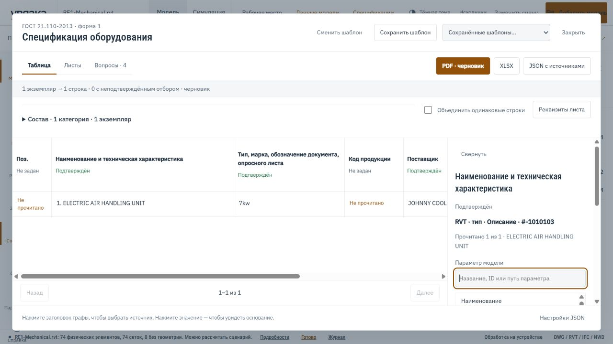

[Попробовать на открытом RVT](https://proovcme.github.io/uvyazka/?project=demo-a&example=rvt-re1) →
**Спецификации → Спецификация оборудования по ГОСТ**.
[Порядок работы и ограничения](docs/GOST_SPECIFICATIONS.md) ·
[Листы и галерея](docs/SCREENSHOTS.md#спецификации-по-гост--alpha14).

Ошибки отдельных записей NWD изолируются: здоровые фрагменты открываются,
пропуски и вопросы сохраняются в журнале. [Правила восстановления и синтетический стенд](docs/NWD.md#восстановление-при-локальных-ошибках).

NWC подключён к тому же независимому читателю. Несколько NWC / NWD / IFC / RVT
можно выбрать сразу и открыть в общей сцене: последовательная очередь,
результат по каждому файлу и продолжение после обычной ошибки.
Совмещение по исходным координатам требует проверки; чтение Navisworks экспериментальное.

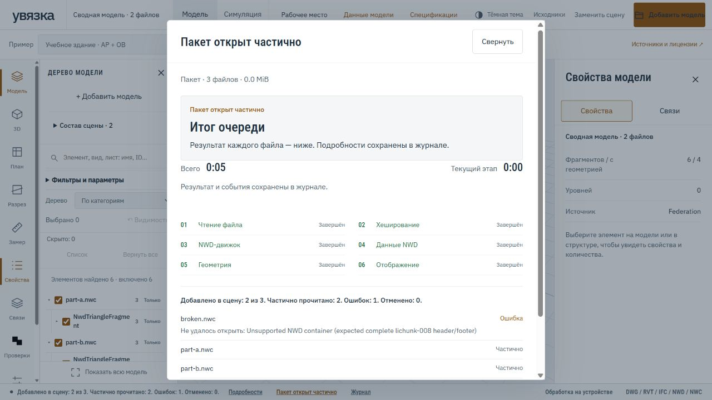

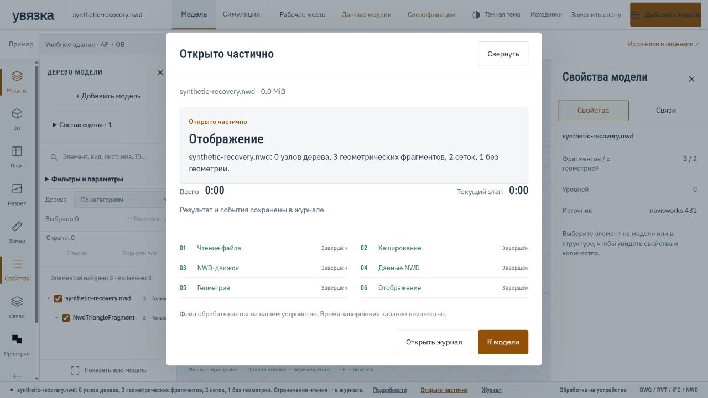

### RVT без промежуточного IFC · эксперимент

[Обновление rvt-rs до 0.11.0: совместимость и проверки](docs/RVT_UPSTREAM_UPDATE.md).

В дереве модели доступна команда **RVT напрямую · эксперимент**. Сохранённые
поверхности, материалы, Revit ID и параметры читаются прямо в сцену вьювера.
Текущий путь через IFC остаётся по умолчанию; один источник можно открыть обоими
способами для сравнения. Прямой режим имеет отдельный охват и не подтверждает
физические количества по числу владельцев графики.
[Как включить и ограничения](docs/RVT_DIRECT.md).

[Независимая сверка RVT с авторскими IFC](docs/RVT_REFERENCE_AUDIT.md) выявляет
различия формы и отсутствующие пары; отрисовка сама по себе не подтверждает
полноту. В свойствах отдельно отмечаются сохранённая графика и габаритные блоки.
[Проверена смешанная сцена RVT + NWD + NWC + IFC](docs/MIXED_SCENE_VALIDATION.md),
включая сохранение и обратное открытие переносимого проекта.
Крупные модели используют пакетную отрисовку поверхностей и исходных линий;
выбор, свойства и замеры сохраняют исходные ID. Дерево переиспользуется при
смене видимости. [Ускорение и диагностика](docs/VIEWER_PERFORMANCE.md).

### Сохранение работы и обновление моделей

Неудачная загрузка сохраняет открытую сцену. В очереди можно пропустить файл,
повторить ошибки или выбрать папку моделей; уже добавленный источник пропускается.
Карточка полноты отдельно показывает геометрию, дерево, свойства, системы и виды.

Сеанс сохраняется в браузере с предложением восстановления после перезагрузки.
Рабочее место можно перенести файлом `.uvz`. Обновление источника сохраняет
прежнюю сцену и переносит видимость только по однозначным исходным ID;
замеры и зависимые результаты требуют перепроверки.
В локальной панели прочитанные модели попадают в общую базу GUI/MCP.
В версии alpha.4 добавлен **«Сохранение и экспорт → Экспорт IFC»**:
вся прочитанная сцена или видимая часть, с размещениями, ID и свойствами.
Это координационный IFC4 с треугольной геометрией, без восстановления
параметрических тел и непрочитанных частей исходника.
[Состав выгрузки и проверка](docs/VIEWER_WORKSPACE.md#экспорт-сцены-в-ifc).

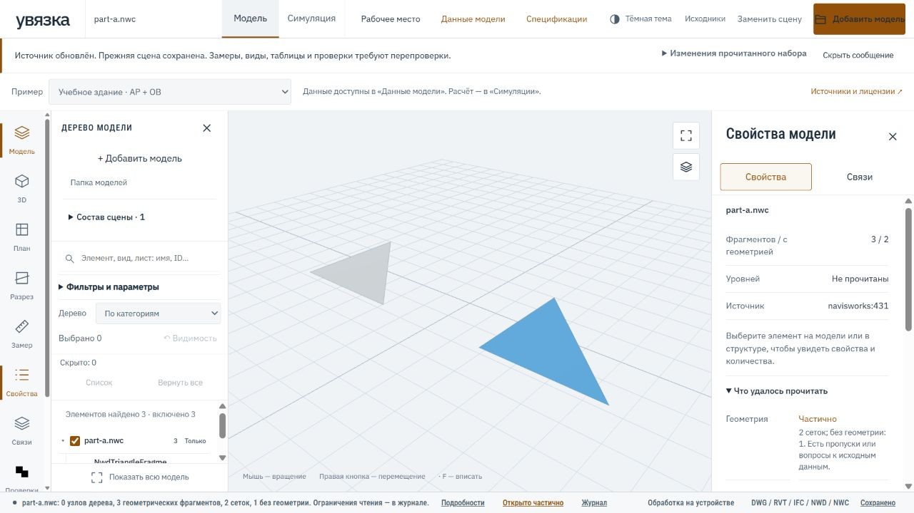

[Возможности и ограничения хранения](docs/VIEWER_RELIABILITY.md).

### Проверка таблиц и источников

В таблицах RVT поддержанные исходные фильтры применяются до группировки,
включая условия по скрытым полям. Неизвестные условия сохраняют статус
неподтверждённого состава. Служебные графы, JSON и журналы доступны в
«Технических данных»; основной экран показывает таблицу, количество и вопросы.
Записи видов без графического отображения вынесены в исходный каталог.

MCP и GUI используют общее ядро построения таблиц. Через
`prepare_model_tables` агент читает RVT напрямую, затем выбирает поля через
`get_model_table_schema`, сохраняет ведомость через `build_model_table` и
получает строки или экспорт с источниками. Поддержаны новые таблицы,
сверочные выборки исходных спецификаций и черновик ГОСТ с XLSX. Единицы вывода
можно выбрать в столбце; неизвестные единицы не угадываются.
[Порядок работы и ограничения](docs/RVT_SCHEDULES.md#общее-ядро-таблиц-для-mcp-и-gui).

В строках исходных таблиц RVT доступен переход к 3D по точному Revit ID и ревизии
файла. Карточка значения показывает происхождение без служебного JSON.
Режим «Только строки с вопросами» помогает разобрать пропуски и конфликты;
экспорт и итоги сохраняют полный состав построенной таблицы.

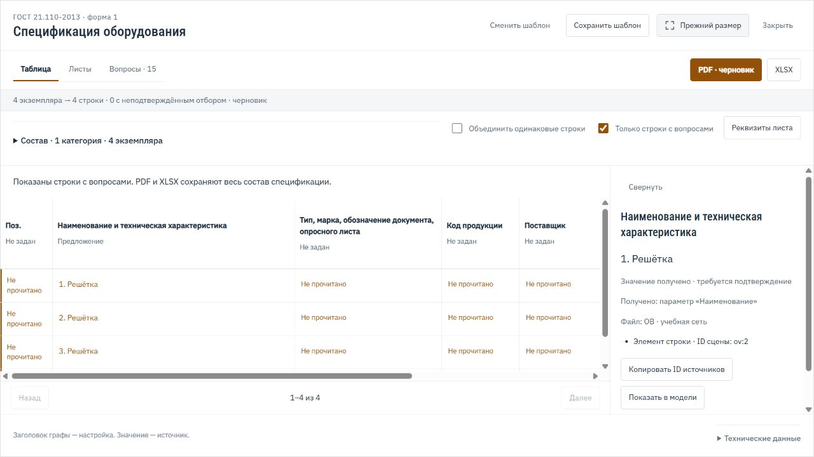

## Код, модель и человек

| Участник | Его работа |
|---|---|
| Код | Читает структуру файлов, хранит адреса и версии, ищет, пересчитывает единицы и арифметику, проверяет заданные связи, учитывает выполненную работу |
| Модель | Определяет смысл данных, читает чертежи и сканы, сопоставляет оборудование и помещения, выбирает проверки, объясняет расхождения и сохраняет основания выводов |
| Человек | Исследует источники, уточняет трактовку, проверяет выводы, продолжает задания и принимает инженерные решения |

Автоматический разбор, независимое чтение модели и принятое значение разделены.
Исправление сохраняет историю и причину. Пропуск не превращается в ноль,
а непроверенный документ — в ошибку проекта.

## Что уже работает

**Alpha: 107 MCP-инструментов и шесть навыков в исходниках.**

| Возможность | Результат |
|---|---|
| [Данные моделей через MCP и API](docs/MODEL_DATA.md) | RVT/IFC/DWG/DXF/NWD/NWC: общие снимки SQLite, исходные ID, параметры, поиск, ссылки на поля и границы чтения; optional-читатели |
| [Проверки геометрии](docs/CLASHES.md) | Составы A/B, пересечения сеток, зазоры, зоны обслуживания, охват, отмена, история, BCF/XLSX |
| [Настольная Увязка](docs/DESKTOP.md) | Windows x64, комплектное ядро и MCP, единая проектная память, подписанные обновления из GitHub |
| [Единый приём проекта](docs/PROJECT_INTAKE.md) | Папка через MCP или локальную панель, ZIP через панель; общие project_id, база и журнал. Существующая папка читается на месте |
| [Листы и таблицы](docs/SOURCE_STRUCTURE.md) | PDF, XLSX/XLSM, XLS, DOCX, CSV/TSV: исходные ячейки, адреса, объединения, формулы и сохранённые результаты, где они доступны |
| [Сводка проекта](docs/PROJECT_SUMMARY.md) | Числовые кандидаты, контекст и источники из сохранённого текста; проверенные наблюдения хранятся отдельно |
| [Поиск по смыслу](docs/SEMANTIC_SEARCH.md) | Необязательная локальная EmbeddingGemma через DigUp worker, точный и совмещённый поиск; адреса и версии фрагментов в общей базе |
| [OCR и независимое чтение](docs/OCR_AND_REVIEW.md) | Адресное распознавание сканов через локальный Tesseract; модель может читать оригинал и сохранять собственную интерпретацию |
| [Проверки с продолжением](docs/REVIEW_WORK.md) | Фиксированный состав строк или объектов, результаты, вопросы, непроверенный остаток и следующий шаг для человека или модели |
| [Сверочная ведомость](docs/REVIEW_REPORT.md) | Полный выбранный состав в Markdown, CSV и JSON: выводы, источники, версии, вопросы и незавершённые проверки |
| [Арифметика ячеек](docs/SOURCE_STRUCTURE.md#пересчёт-скалярной-арифметики) | Точный пересчёт поддерживаемых выражений XLSX/XLSM, цепочки зависимостей и сравнение с сохранённым результатом Excel |
| [Проектные единицы](docs/PROJECT_UNITS.md) | 140 обозначений, точные преобразования и сверка сопоставимых значений с учётом основания измерения |
| [Увязка разделов](docs/PROJECT_COORDINATION.md) | Общие помещения, оборудование, требования и подключения; проверка заданных цепочек до источника, в том числе через щиты |
| [Измерения PDF](docs/MEASUREMENTS.md) | Отдельные виды со своими масштабами, длины и площади, контуры на источнике, история и пересчёт после изменения калибровки |
| [Данные RVT](docs/RVT_DATA.md) | Нативное чтение параметров, систем, видов, листов и сохранённых спецификаций; отдельная проверяемая конверсия в IFC без Revit |
| [Планирование и моделирование](docs/CONSTRUCTION.md) | Объёмы, выработка, ресурсы, зависимости, критический путь, сценарии, CSV/JSON и симуляция на основе интегрированного IFCCS |

Текстовый поиск также работает с TXT/Markdown. Шесть навыков задают порядок
чтения проекта, сверки, подготовки графика, ПОС, ППР и оценки влияния изменений.
[Порядок чтения и сопоставления](skills/aec-project-reader/references/reading-order.md).

## Как работать с проектом

1. **Принять источники.** Указать папку в панели или передать её модели через
   `import_project_folder`. Выбрать тот же проект при продолжении работы.
2. **Собрать основу.** Получить сводку, проверить пропуски чтения, открыть каталог
   листов и таблиц. Для существующего проекта — «Собрать структуру» или
   `build_project_structure`. Пропущенные документы остаются видны.
3. **Прочитать и сопоставить.** Модель получает нужные окна таблиц через
   `read_structure_table`, обращается к оригиналам и сохраняет интерпретации
   и проверки через `save_structure_analysis`.
4. **Зафиксировать объём проверки.** `create_review_task` сохраняет выбранные
   строки или объекты. Результаты связываются с конкретной ревизией разбора:
   совпадение, расхождение, вопрос или непроверенный пункт.
5. **Продолжить в другой сессии.** `get_review_tasks` возвращает состояние,
   остаток и следующий шаг. В панели доступна та же очередь. Изменение источника
   или связанного вывода возвращает затронутые пункты на перепроверку.

Например, можно поручить модели:

> Сопоставь оборудование ОВ со спецификациями и заданиями ЭОМ и автоматики.
> Сохрани источники и основания соответствия. Раздели подтверждённые
> расхождения, вопросы и непрочитанный объём. Зафиксируй состав проверки,
> чтобы её можно было продолжить в следующей сессии.

Полнота считается **в пределах выбранного состава**. Закрытая проверка десяти
строк не означает, что проверен весь проект. Вопрос может быть исследован
и сохранён, оставаясь открытым инженерным вопросом.

## Быстрый старт на Windows

Нужны Python 3.11+ и [uv](https://docs.astral.sh/uv/).

```powershell
git clone https://github.com/proovcme/uvyazka.git
cd uvyazka
uv sync --extra all
uv run uvyazka demo
uv run uvyazka dashboard
```

Откройте **http://127.0.0.1:8772**. Два учебных проекта содержат синтетические
данные. Для своего проекта выберите существующую папку в разделе приёма.
Документы, базы и кеши пользователя в репозиторий не входят.

Базы по умолчанию находятся в `%LOCALAPPDATA%\uvyazka` на Windows.
Панель и MCP должны использовать одинаковый `UVYAZKA_HOME` или значение
`--home`, чтобы работать с одной памятью проекта.

Для OCR нужен Tesseract. Нативное чтение RVT и дополнительные BIM-возможности
требуют отдельной установки зависимостей и сборки:
[полная инструкция](docs/INSTALLATION.md), [RVT-runtime](integrations/README.md).

## Подключение MCP

```powershell
uv run uvyazka client-config codex
```

Команда **выводит** настройки текущей установки; добавьте их в конфигурацию
клиента, сохранив остальные серверы. Есть профили `claude-desktop` и
`gemini-cli`. Совместимость с Gemini Desktop не заявляется.

Проверен stdio-протокол. Установка и работа в конкретном настольном клиенте
требуют отдельной приёмки. Модель и диалог остаются в вашем клиенте;
переданные через MCP фрагменты обрабатываются по его настройкам.

## Панель

**Локальная панель — рабочее место проекта.** Портфель, приём документов,
показатели и источники, листы и таблицы, сохранённые разборы, очередь проверок,
измерения и работа с моделями доступны поверх той же базы, что использует MCP.

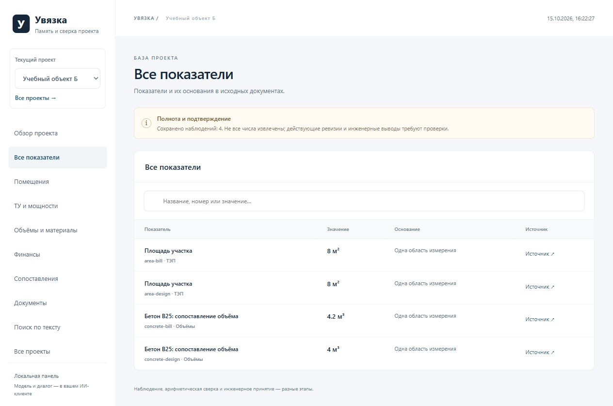

| Сопоставление количеств | Происхождение числа |
|:---:|:---:|
| [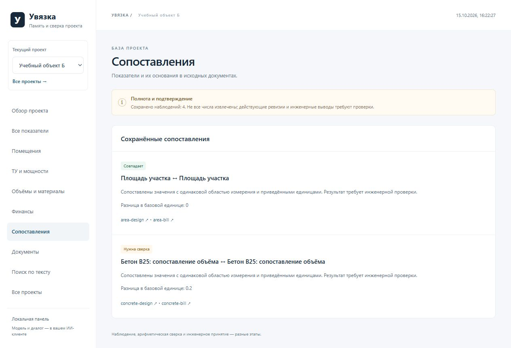](docs/SCREENSHOTS.md#совпадения-и-вопросы) | [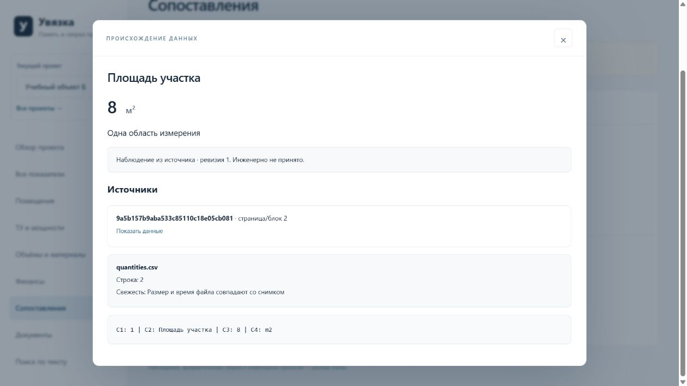](docs/SCREENSHOTS.md#происхождение-числа) |
| Совпадения, расхождения и связанные наблюдения | Файл, ревизия, адрес строки и исходный текст |

Локальная загрузка RVT запускает чтение данных, конверсию и диагностику.
Исходный файл остаётся на компьютере. Если геометрия не поддержана,
это отражается в журнале; каталог данных может читаться независимо от неё.

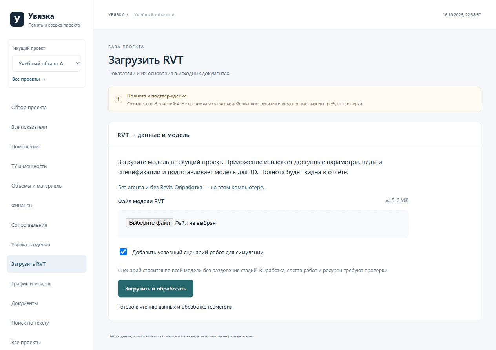

Эти экраны сняты на синтетических данных. [Полная галерея](docs/SCREENSHOTS.md).

## Рабочее место вьювера — локальная рабочая версия

Добавлены инженерная навигация по системам и портам с источниками связей,
сохранённые сцены, подборки, сравнение ревизий, множественное выделение,
отмена видимости и замеры с привязками к сетке. Локальная панель и MCP
обмениваются состоянием через SQLite проекта; геометрия хранится отдельно.
Публичное демо обновляется отдельной выкладкой.

[Как пользоваться, контракт состояния и ограничения](docs/VIEWER_WORKSPACE.md).

## Веб-демо: вьювер и симуляция

**[Открыть демо](https://locia.work/uvyazka/)** ·
[GitHub Pages](https://proovcme.github.io/uvyazka/)

Публичное демо — отдельное браузерное приложение. В нём есть клиника с АР,
ОВ и ЭОМ, сводная модель, открытый RVT и учебный каркас со сценариями ресурсов.
Пользовательские файлы обрабатываются на устройстве, без отправки на VPS.

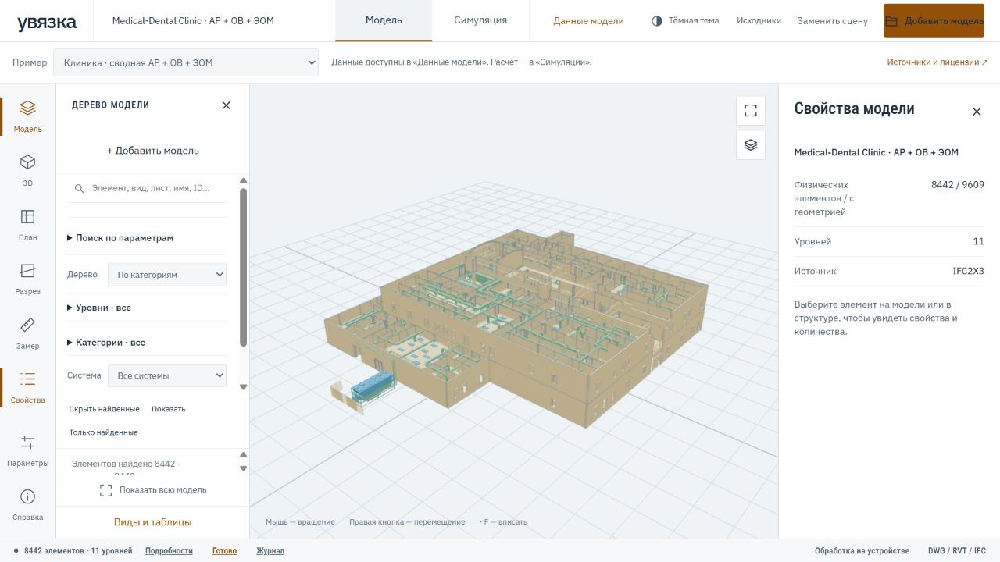

- IFC/RVT: дерево модели, категории, уровни, системы, поиск элементов и
  параметров, скрытие и изоляция, копируемые свойства и доступные исходные ID.
- DWG/DXF: отдельный CAD-вьювер со слоями.
- Видимость: список скрытых элементов после снятия выделения, возврат галочкой
  или «Вернуть все» с сохранением поиска и положения камеры.
- [NWD и NWC](docs/NWD.md): экспериментальное прямое чтение геометрии, исходного дерева и типизированных свойств; единицы из прочитанного заголовка либо явное допущение пользователя.
- [Спецификации по параметрам](docs/PARAMETER_SPECIFICATIONS.md): поля, условия, группы, сортировка, итоги и CSV/JSON с источниками; RVT, IFC и прочитанные данные NWD. Для RVT — отдельные значения экземпляра/типа, многокатегорийные сверочные ведомости и поддержанная часть сохранённых фильтров с журналом отбора.
- [Шаблон оборудования по ГОСТ](docs/GOST_SPECIFICATIONS.md): форма 1, настройка источников по графам, листы А3 с основными надписями, PDF, XLSX и JSON с доказательствами. Первая версия считает оборудование в штуках; неизвестные значения остаются вопросами.
- RVT: каталог прочитанных видов, листов и сохранённых данных спецификаций.
- IFC/RVT: расчёт сценария и симуляция; линии DWG сами по себе не задают работы.

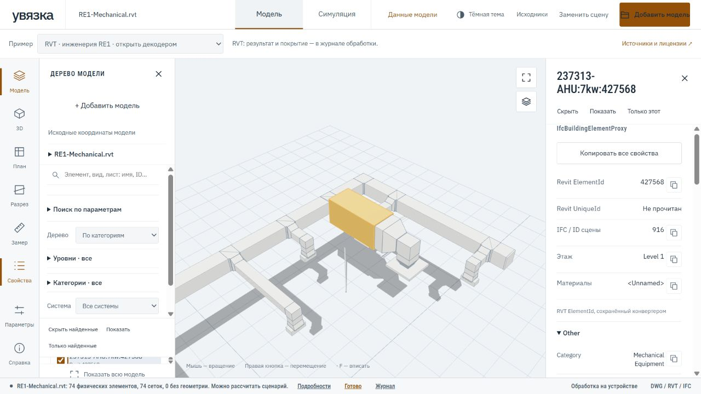

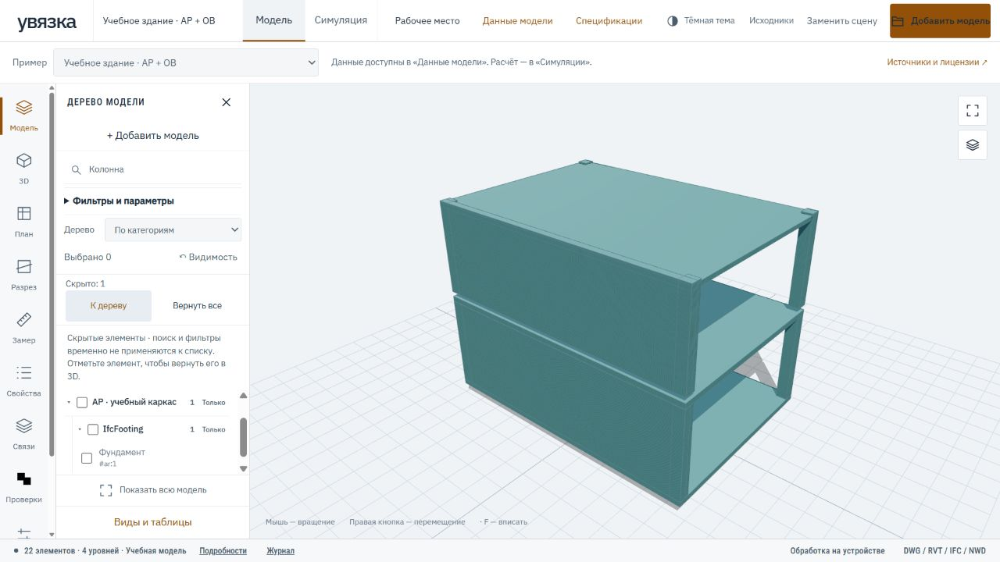

Рабочие окна разворачиваются кнопкой «На весь экран» и меняют размер за угол.

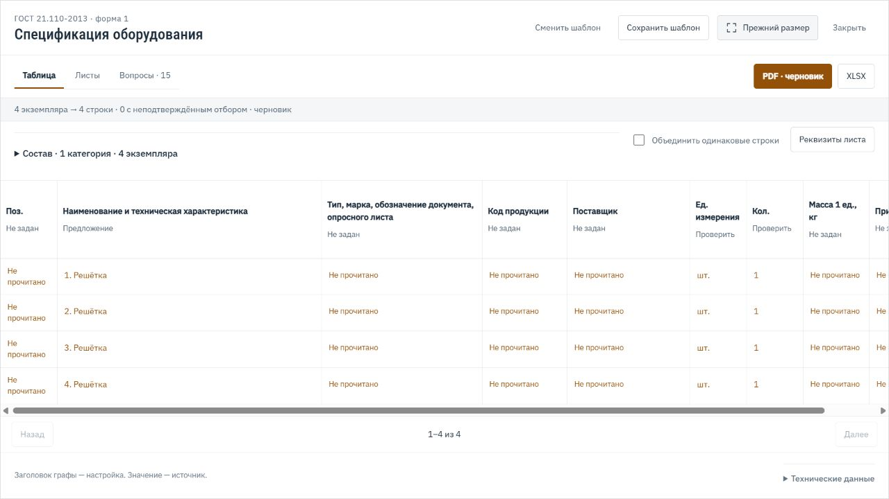

«Скрыто: N → Список» показывает вручную скрытые элементы независимо от поиска.
Галочка возвращает отдельный элемент, «Вернуть все» — все скрытые.
Снимок от 27.10.2026 сделан на полностью синтетическом учебном каркасе.

В примере **RVT · инженерия RE1** браузер скачивает исходный RVT и запускает
декодер. Этапы чтения, конверсии и отображения видны в окне обработки;
диагностика сохраняется в журнале. Чтение остаётся частичным: наличие геометрии
не означает восстановления всех данных Revit.

Снимки сделаны 26.10.2026 на открытых моделях: Medical-Dental Clinic —
BSI (2020), buildingSMART International, CC BY 4.0; RE1-Mechanical —
Drshelden, MIT. [Источники и изменения](docs/DEPENDENCIES.md#демонстрационные-материалы) ·
[Галерея: обработка RVT, поиск и данные](docs/SCREENSHOTS.md#веб-вьювер--26-октября-2026).

Демо обновляется отдельно от локального инструментария. Его каталог можно
перенести в локальный проект через JSON; автоматического доступа к вашей
локальной базе у публичного сайта нет.

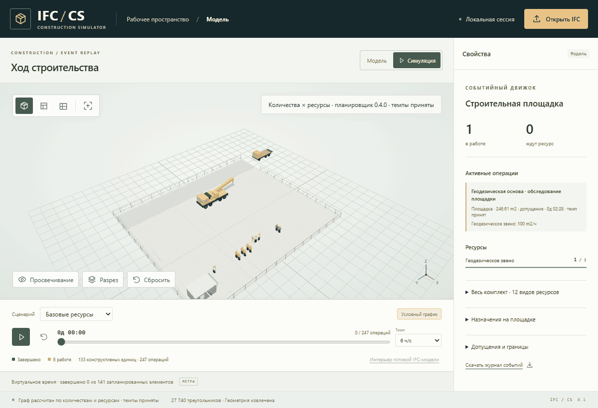

GIF показывает демонстрацию IFCCS 0.4; в код Увязки перенесён IFCCS 0.5.
Образец Duplex: buildingSMART International, CC BY 4.0;
[источник и условия](docs/DEPENDENCIES.md#демонстрационные-материалы).
[Вьювер](docs/VIEWER.md) · [Сборка и ограничения демо](docs/PUBLIC_DEMO.md).

## Границы текущей версии

- **Полный автоматический аудит проекта не реализован.** Шапки таблиц,
  числовые кандидаты и связи требуют проверки смысла моделью или человеком.
  Исчерпывающее извлечение всех показателей и нормоконтроль по ГОСТ не заявляются.
- OCR и сложные таблицы могут давать ошибки. Старый бинарный DOC не поддержан;
  у XLS не восстанавливаются выражения формул. Логические части DOCX
  не выдаются за физические страницы.
- Пересчёт XLSX/XLSM поддерживает числа, адреса ячеек одного листа,
  арифметические операции и скобки. Функции Excel, диапазоны, внешние ссылки
  и макросы не исполняются. Согласованный итог не доказывает правильность
  исходного объёма работ.
- Соответствие оборудования между разделами и требования задаёт модель
  или человек. Найденный путь подключения не подтверждает достаточность
  мощности, защиты или пропускной способности сети.
- Поддержка RVT зависит от версии и содержимого файла. Оформленные листы
  и все вычисляемые строки спецификаций не восстанавливаются; универсальное
  открытие любых RVT не обещается.
- График и симуляция зависят от введённых объёмов, производительности,
  связей и ресурсов. Приближённая геометрия обозначается отдельно.
  Автоматического выпуска готовых к утверждению ПОС/ППР пока нет.

[Подробный статус и проверки](docs/STATUS.md).

## Документация

| Раздел | Что внутри |
|---|---|
| [Установка](docs/INSTALLATION.md) | Свои проекты, MCP-клиенты, навыки, расположение базы |
| [Инструменты и данные](docs/DATA_MODEL.md) | MCP-инструменты, наблюдения, источники и сравнение |
| [Единый приём проекта](docs/PROJECT_INTAKE.md) | Папка/ZIP, общий журнал и продолжение |
| [Автоматическая сводка](docs/PROJECT_SUMMARY.md) | Числовые кандидаты, контекст и источники |
| [Листы, таблицы и независимое чтение](docs/SOURCE_STRUCTURE.md) | Исходные ячейки, интерпретации, арифметика и версии |
| [Проверки с продолжением](docs/REVIEW_WORK.md) | Общая очередь человека и модели, остаток и перепроверка |
| [Проектные единицы](docs/PROJECT_UNITS.md) | Обозначения, точные пересчёты и основания измерения |
| [Измерения PDF](docs/MEASUREMENTS.md) | Виды, масштабы, контуры, история и пересчёт |
| [Увязка проекта](docs/PROJECT_COORDINATION.md) | Факторы согласованности и границы проверок |
| [RVT](docs/RVT_DATA.md) | Данные, системы, виды, спецификации и конверсия |
| [Качество просмотра RVT](docs/RVT_VIEWER_QUALITY.md) | Критерии приёмки, кеш повторного открытия и проверенные операции |
| [Планирование](docs/CONSTRUCTION.md) | IFCCS, объёмы, ресурсы, сценарии и моделирование |
| [Порядок чтения проекта](skills/aec-project-reader/references/reading-order.md) | Последовательность чтения и сопоставления |
| [Архитектура](docs/ARCHITECTURE.md) | Ядро, MCP, навыки и интеграции |
| [План разработки](docs/ROADMAP.md) | Следующие этапы |
| [Технологические карты](docs/TECHNOLOGY_LIBRARY.md) | Источники ТТК и проверка применимости |
| [Экосистема](docs/ECOSYSTEM.md) | Независимые MCP и дополнительные интеграции |
| [Разбор DigUp](docs/DIGUP_REVIEW.md) | Устройство worker, выбранные решения, ограничения исходных читателей и выдачи |
| [Зависимости](docs/DEPENDENCIES.md) | Происхождение и условия использования кода и материалов |

Из [Л.И.С.Т.](https://github.com/proovcme/les-list) перенесены выбранные функции
чтения структуры и таблиц: [состав и границы переноса](docs/LES_LIST_REVIEW.md).
ЛЕС остаётся самостоятельным MCP; варианты его интеграции и RAG-Legion
описаны в экосистеме и не являются обязательными зависимостями Увязки.

## Лицензия

Собственный код, документация и навыки Увязки распространяются под
[Apache License 2.0](LICENSE), кроме компонентов с отдельно указанными условиями.
Лицензия разрешает коммерческое использование и модификацию, содержит явное
предоставление патентных прав участников и требует сохранять необходимые
уведомления и отмечать изменения.

Сторонние компоненты, шрифты и демонстрационные материалы сохраняют свои лицензии.
В частности, отдельное DWG-приложение `integrations/cad-viewer` — GPL-3.0-or-later;
Apache 2.0 Увязки не меняет его условия или условия опционального PyMuPDF.
[Уведомления](NOTICE) · [Зависимости и происхождение](docs/DEPENDENCIES.md).
Лицензия репозитория не распространяется на загружаемые пользователем проекты.

## Разработка

```powershell
uv sync --extra all
uv run python -m unittest discover -s tests -v
uv run python tools/validate_package.py
uv run python tools/check_public_content.py
uv build
uv run python tools/check_public_content.py --archive dist/uvyazka-0.4.0a3.tar.gz --archive dist/uvyazka-0.4.0a3-py3-none-any.whl
```

Фронтенд — каталог `web`: `npm ci`, `npm test`, `npm run build`.
CI содержит проверки Python для Windows/Linux, фронтенда и дополнительных
BIM-компонентов. Тестовые документы создаются синтетически; реальные проекты,
базы, кеши и секреты в коммиты не включаются.
CI также проверяет историю Git с Gitleaks 8.30.1 и состав готовых wheel/sdist:
неотслеживаемый файл в папке исходников не должен попасть в публичный архив.
Проверка не заменяет просмотр скриншотов и инженерных отчётов перед публикацией.
