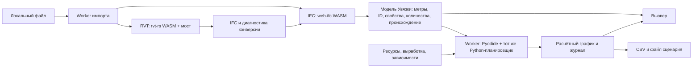

# Демо: свой IFC или RVT, расчёт в браузере

Цель: пользователь открывает файл с компьютера, видит модель, получает
предварительный граф работ, меняет ресурсы и воспроизводит пересчитанный
сценарий. Всё это выполняется на его устройстве. VPS раздаёт приложение,
WASM и расчётные модули. Для этого пути не нужен сервер обработки моделей.

Это план следующей версии. Опубликованное демо пока воспроизводит готовые
синтетические расчёты; загрузка своих файлов в него ещё не включена.

В локальной панели уже есть загрузка RVT без агента: она передаёт файл
локальному Python/Rust-процессу, сохраняет данные/IFC и готовит условную
симуляцию. [Описание](RVT_DATA.md#загрузка-в-панели-без-агента).
Перенос этого процесса в browser worker остаётся отдельным этапом.

## Что уже есть и что дописываем

| Часть | Основа | Оставшаяся работа |
|---|---|---|
| Отображение и симуляция | Three.js, сцены, площадка, воспроизведение журнала Увязки | Принимать модель и новый расчёт из worker, освобождать прежние ресурсы |
| Расчёт | Python SimulationEngine 0.1.1 и planner 0.5 | Сборка модулей для Pyodide и обмен сообщениями с worker |
| IFC в браузере | web-ifc/WASM; уже используется в отдельном «Атласе» | Адаптер идентификаторов, единиц, свойств, количеств и геометрии в контракт Увязки |
| RVT локально | Включённый rvt-rs, CLI-конвертер, reader стадий/параметров/видов/спецификаций | Проверка покрываемых версий и элементов на разных моделях |
| RVT в браузере | Включённые rvt-wasm и собственный rvt-browser-bridge | JS-обвязка, worker, чтение стадий и проверка совпадения с CLI |

В rvt-wasm есть открытие массива байтов и экспорт IFC, но его исходная
обвязка не повторяет шаг CLI `--saved-meshes`. Поэтому добавлен отдельный
мост `integrations/rvt-browser-bridge`: тот же экспорт, подключение сохранённых
сеток, пересчёт диагностики и проверка наличия геометрии. Если геометрия
не получена, мост возвращает диагностику и не выдаёт пустой IFC за результат.
Это ещё не подключённый загрузчик публичной страницы.

## Как пойдут данные

**Один расчётный код.** На первом этапе запускаем Python-ядро через Pyodide
в отдельном module worker. Не переписываем алгоритм распределения ресурсов
на JavaScript одновременно с вводом нового импорта. Это уменьшает риск,
что локальная версия и браузер дадут разные сроки. Native-зависимости
планировщика отделены от импорта IFC; проверка этого разделения уже есть
в тестах. Реальный запуск всего выбранного набора модулей в Pyodide ещё
нужно проверить. Если размер или скорость окажутся неприемлемыми, решение
пересматривается по измерениям, а новая реализация проходит те же эталоны.

**Два импорта — один контракт.** Обычный IFC поступает в web-ifc напрямую;
RVT сначала преобразуется в IFC с сохранением Revit ElementId/GlobalId,
BodySource и диагностики. Затем оба пути формируют пакет модели Увязки.
Геометрию держим с исходной точностью до передачи в GPU. Явные количества
из файла и вычисленные по сеткам величины храним раздельно, с единицами,
методом получения и статусом. Габаритная коробка RVT не становится объёмом.

**Стадии требуют данных.** Для RVT отдельно переносим чтение сохранённых
ProjectPhase/AllProjectPhases и стадий создания/демонтажа элементов.
Тот же phase_projection проверяется на native и браузерном результате.
Пока подтверждённых стадий нет, показываем «не прочитаны»; по именам и
порядку ElementId их не восстанавливаем. Фазы разных файлов не склеиваем.

**Качество конверсии видно до графика.** Число прочитанных элементов,
элементов с геометрией, коробок, пропусков и объектов вне графика показываем
отдельно. Полноту считаем только при известном составе исходника.
Успешное открытие IFC в браузере не заменяет EXPRESS-проверку IfcOpenShell
настольного пути. Область выполненной проверки должна быть указана явно.

## Интерфейс

1. «Открыть IFC / RVT» и готовый учебный пример. Сначала имя, размер,
   формат, версия и состояние чтения; затем модель и диагностика покрытия.
2. Вьювер: дерево разделов/этажей/классов, выбор объекта, свойства,
   количества с происхождением, скрытие, разрез и общая камера.
3. Сценарий: исходные допущения IFCCS, выработка, состав бригад,
   количество техники и длительности ожиданий. Отдельное действие «Рассчитать».
4. Симуляция: Гант, ожидания ресурсов, текущие работы, площадка,
   пауза/перемотка, автопоказ и сравнение вариантов.
5. Выгрузка графика CSV, результата JSON и полученного IFC для RVT.
   Загрузка файла сценария восстанавливает расчётные входы и версии движка.

Модель ИИ и чат в это демо не добавляются. IFCCS предлагает предварительные
работы; человек или агент проверяет технологию, производительность и связи.
Непрерывные расчётные минуты остаются отдельно от календарных дат.

## Порядок реализации и приёмка

| Этап | Что выпускаем | Условие готовности |
|---|---|---|
| 0 | Перенос исходников, сборка RVT и метаданных в Увязке | Сборка без каталога IFCCS; синтетический smoke; реальный RVT проверяется только локально |
| 1 | Пересчёт имеющихся учебных сценариев в Pyodide worker | На одинаковом входном сценарии совпадают начала/окончания всех работ, ожидания, ресурсы, события и итог CPython/Pyodide |
| 2 | Собственный IFC → пакет модели → расчёт → симуляция | Оси, координаты, единицы, GlobalId, явные количества и исключённые объекты проверены; незамкнутая сетка не даёт ложного объёма |
| 3 | RVT WASM, сохранённые сетки, стадии, скачивание IFC | Native и WASM сопоставлены по ElementId/GlobalId, классам и покрытию; расхождения показаны; устаревший/неподдерживаемый RVT даёт понятный результат |
| 4 | Сравнение вариантов, восстановление сессии, публикация | Повторяемый расчёт, корректная перемотка, освобождение памяти, отмена и отсутствие отправки модели на сервер |

Расчётные эталоны: параллельные работы, общий кран, дефицит бригад, циклы,
демонтаж, существующие/будущие элементы, длинная выдержка и отсутствие объёма.
Для геометрии разными тесселяторами задаётся обоснованный допуск на конкретную
величину; его нельзя использовать для сокрытия ошибки единиц или состава.
Числа из явных ведомостей сверяются после точного приведения единиц.

## Выполнение, память и сохранение

Операции импорта и расчёта имеют job_id и поколение открытой модели.
Результат старой задачи не заменяет новую модель. Отмена завершает worker,
после чего создаётся новый; интерфейс продолжает работать. Большие буферы
передаются как transferable, прежние сетки и WebGL-ресурсы освобождаются.

Начальный предел собственного RVT-моста — 64 MiB входного файла. Это
ограничение прототипа, не обещание, что любой файл такого размера обработается:
расход памяти зависит от распаковки, числа объектов и сеток. До увеличения
лимита измеряем память/время на нескольких классах моделей и устройствах.
Локальный инструмент остаётся путём для более крупных моделей; скрытого
переноса расчёта на VPS при нехватке памяти не будет.

В первой версии состояние хранится в памяти вкладки и выгружаемом файле.
IndexedDB и несколько одновременно открытых проектов — следующий шаг,
после проверки изоляции и лимитов. Браузер не получает произвольный доступ
к папкам компьютера и не заменяет локальную проектную SQLite-базу MCP.

WASM, Pyodide, JS и Python-модули размещаются на locia.work с фиксированными
версиями и хешами. Загрузка библиотек и модели в worker разделены. Приёмка
проверяет сетевой журнал: уходят запросы за статическими ресурсами,
байты пользовательского файла не отправляются. После загрузки ресурсов
проверяется расчёт при отключённой сети. CSP/worker-заголовки проверяются
на работающей сборке; защита остальных приложений сайта сохраняется.

## Основания выбора

- [Исходники rvt-rs](https://github.com/DrunkOnJava/rvt-rs), фиксированный снимок
  в integrations/rvt-rs/UVYAZKA-SOURCE.json; WASM API и CLI проверены по коду.
- [web-ifc](https://github.com/ThatOpen/engine_web-ifc) — чтение IFC в JS/WASM.
- [Pyodide в Web Worker](https://pyodide.org/en/stable/usage/webworker.html) —
  запуск Python вне потока интерфейса; конкретную версию фиксируем при прототипе.

## RVT: данные и виды тоже без Revit

Локальное [чтение RVT](RVT_DATA.md) отделено от геометрической конверсии.
В браузерный мост нужно перенести тот же нативный маршрут записей: стабильные
ID, параметры и единицы, настройки видов, размещения и определения таблиц.
Держать их в worker и выдавать адресные фрагменты, а не передавать весь граф
модели в контекст ИИ. Экспортёр Revit API не является обязательным этапом.

Вычислитель спецификаций развивается отдельно: сначала подтверждённые прямые
поля и фильтры, затем типы, группировки/итоги, выражения, материалы и связи.
Для каждого неподдержанного правила возвращать причину и частичный статус.
Собственную ведомость модели нельзя выдавать за оригинальную спецификацию.
Виды из геометрии помечать реконструкцией до проверки покрытия обрезки,
видимости, аннотации и оформления. Полноценного RVT-чертёжного рендера пока нет.
