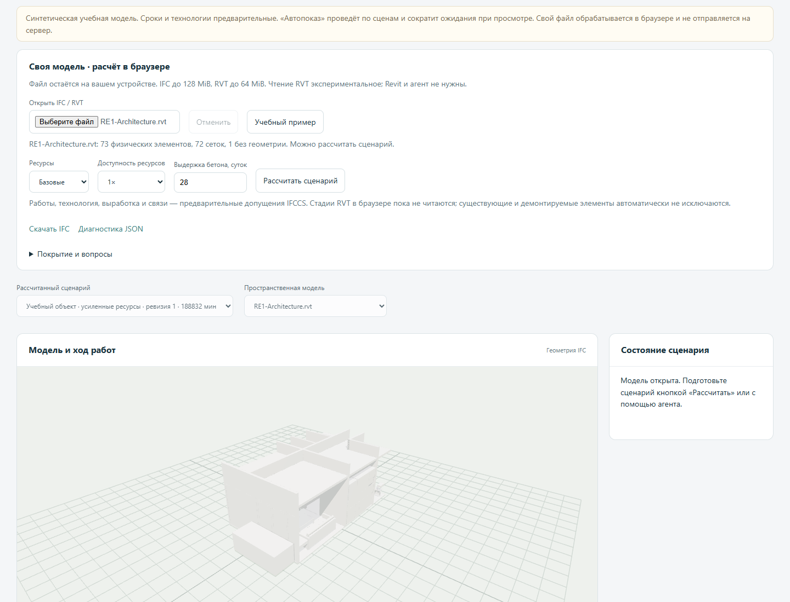

# Проверка браузерного IFC/RVT: 17 октября 2026

Проверена сборка 0.3.0-alpha.5 в Chrome на Windows, с рабочей CSP сайта:
`script-src 'self' 'wasm-unsafe-eval'`, без разрешения обычного eval.
Это проверка конкретных моделей, не сертификация поддержки любых RVT/IFC.



Источники: [IFC-ECS, RE1](https://github.com/Drshelden/IFC-ECS/tree/9e8b37175a0fba1397f7011aeee917fe52de7623/data/RE1)
и [buildingSMART Community Sample Test Files](https://github.com/buildingsmart-community/Community-Sample-Test-Files/tree/7ddf57a201f88a0c213d5322b02ed15e94a60a40).
Версии URL, размеры и SHA-256 закреплены в [манифесте](../tools/browser-fixtures.json).
Тестовые модели скачиваются в игнорируемый каталог; в репозиторий и публичный сайт
сами файлы моделей не включены.

| Файл | Физических элементов | Сеток | Работ | Вне графика |
|---|---:|---:|---:|---:|
| RE1 Architecture RVT | 73 | 72 | 132 | 42 |
| RE1 Mechanical RVT | 74 | 74 | 516 | 1 |
| RE1 Plumbing RVT | 124 | 124 | 692 | 0 |
| RE1 Electrical RVT | 49 | 49 | 132 | 30 |
| RE1 Architecture IFC | 73 | 72 | 132 | 42 |
| RE1 Mechanical IFC | 74 | 74 | 515 | 1 |
| RE1 Plumbing IFC | 123 | 123 | 688 | 0 |
| RE1 Electrical IFC | 49 | 49 | 131 | 30 |
| Duplex A IFC2X3 | 218 | 215 | 484 | 77 |
| Wall / opening / window IFC4 | 2 | 2 | 9 | 0 |

Для каждого из 10 файлов проверены выбор файла через UI, импорт, 3D,
планирование и проигрывание. На одном и том же пакете извлечённых данных
CPython и Pyodide независимо построили совершенно одинаковые сценарии,
журналы, сроки, состояния ресурсов и критический путь. После отключения сети
удвоение ресурсов и повторный расчёт дали точное совпадение с CPython.
Также проверены отмена тяжёлого RVT, смена файла без принятия устаревшего результата,
понятная ошибка повреждённого RVT и скачивание CSV.
Сетевые запросы — только GET статических ресурсов своего origin; отправок
содержимого моделей и обращений к внешним API не было.

Нативная конверсия RVT с `--saved-meshes` сопоставлена с WASM по GlobalId,
классам физических элементов, наличию сеток и разрешению использовать
геометрию для количеств. Расхождений в этих признаках на RE1 нет.
В инженерных RVT совпали 5, 8 и 13 систем и их состав в IFC.
На девяти сопоставимых файлах наибольшее отличие границы bounding box между
web-ifc и IfcOpenShell — около 0,00071 м. Это наблюдение на данном корпусе,
а не допуск для приёмки реального проекта. Тесселяция, количества и итоговые
сроки из RVT и исходного IFC могут различаться; их равенство не заявляется.

## Найденные вопросы

- Некоторые классы не имеют технологического шаблона и остаются вне графика.
  Состав модели и состав работ показаны отдельно.
- В паре RE1 Plumbing RVT/IFC есть различие 124/123 физических элементов.
  Исходные авторские экспорты не считаются равными автоматически.
- Нативный IfcOpenShell 0.8.5 и 0.9.0.post1 при сочетании IfcProject и
  IfcProjectLibrary в примере wall-window теряют единицы в геометрическом
  движке: 3000 мм становятся 3000 м, хотя Python-утилита распознаёт миллиметры.
  Нативный импорт теперь останавливается при таком контексте, а не сохраняет
  неверные метры. Браузер даёт габарит 3 × 0,3 × 2 м. Синтетическая регрессия
  закрепляет отказ до публикации неверной геометрии. Извлечение native-геометрии
  из такого IFC остаётся неподдержанным.
- Стадии RVT в браузере не читаются. Исходная топология инженерных сетей,
  расчёты подключений и исходные вычисленные спецификации не проверены.
- Объём из незамкнутого меша не вычисляется. Неизвестные BodySource и коробки
  RVT не дают объёмы/площади для планирования; используется явное допущение
  поштучного расчёта. Даже замкнутый меш требует инженерной проверки.

## Повторение

После сборки [браузерного демо](PUBLIC_DEMO.md):

```powershell
uv run python tools/fetch_browser_fixtures.py
uv pip install playwright
uv run python tools/serve_browser_demo.py
# В другом терминале, с установленным Chrome:
$fixtures = (Get-ChildItem .uvyazka-build/browser-fixtures -File).FullName
uv run python tools/check_browser_runtime.py --url http://127.0.0.1:8779/uvyazka/ $fixtures
uv run python tools/compare_browser_geometry.py $fixtures
```

Отчёты и снимки сохраняются в `.uvyazka-build/browser-verification/`.
Для CI вместо установленного Chrome можно поставить Playwright Chromium
и передать `--channel chromium`.
