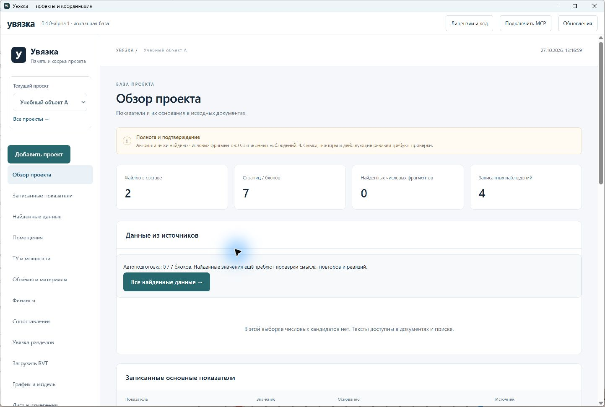

# Увязка для Windows

Настольная сборка включает Python-ядро, локальную панель, MCP, приём проекта,
читатели документов, структуру листов и таблиц, вьювер, спецификации,
геометрические проверки и IFCCS. Пользователю не нужно устанавливать Python,
Node.js или Rust. Revit и AutoCAD не требуются для прямого чтения файлов.
Ограничения декодеров остаются теми же, что в [веб-вьювере](DIRECT_FILE_READING.md).

Текущий выпуск — **0.4.0-alpha.3**. [Изменения и ограничения](RELEASE_0_4_0_ALPHA_3.md).
Канал — предварительные выпуски для Windows x64.
[Установщики и исходники](https://github.com/proovcme/uvyazka/releases).
Используется WebView2; установщик может получить стандартный runtime Microsoft,
если его нет на компьютере. Сертификат Windows Authenticode не входит в первую
сборку: подпись обновлений Tauri и подпись издателя Windows — разные механизмы.

## База и MCP

По умолчанию состояние хранится в `%LOCALAPPDATA%/uvyazka`, отдельно от программы.
`UVYAZKA_HOME` позволяет выбрать другое место. Если там уже есть проекты локальной
Увязки, приложение использует их же. Реальные проекты в установщик не включаются.

Кнопка **Подключить MCP** показывает готовые настройки для Codex и Claude/Gemini.
Команда — установленный `uvyazka-core.exe --mcp`, каталог состояния совпадает
с панелью. MCP работает и при закрытом окне приложения. Настройка клиента
не изменяется без действия пользователя. Навыки приложены к установленному ядру.
Приложение использует постоянный адрес `http://127.0.0.1:17881`, чтобы сохранять
браузерные настройки между запусками. Повторный запуск поднимает существующее окно.
Если порт занят другой программой, приложение не подключается к ней автоматически.

Поиск по точным данным работает без весов модели. Для OCR требуется отдельно
доступный Tesseract с языками; для необязательного поиска по смыслу — DigUp worker
и веса. Эти внешние программы и веса не выдаются за часть установщика.

## Обновления

Кнопка **Обновления** проверяет HTTPS-канал beta на GitHub Pages.
Установщик скачивается из GitHub Releases, а Tauri проверяет его Ed25519-подпись
встроенным открытым ключом. Неверная подпись не допускает установку. Закрытый ключ
не входит в репозиторий, исходный архив, приложение или веб-демо.

Перед заменой программы приложение:

1. Проверяет активные приём проектов, RVT-обработку, геометрические задания
   и процессы комплектного MCP. Их нужно завершить или отключить.
2. Создаёт согласованные копии SQLite средствами SQLite Backup API в
   `backups/desktop-…`. Исходные папки проектов не удаляются и не копируются
   в этот архив баз.
3. Закрывает запись локальной панели, останавливает своё ядро и запускает установку.
4. Перезапускает приложение. При сбое установки ядро можно запустить вновь.

Текущий выпуск добавляет таблицы без разрушительных миграций старых данных.
Это не универсальная гарантия совместимости с будущими схемами. Автоматического
удаления проектов, установки при каждом старте и принудительного отката баз нет.
Без сети проектная панель продолжает работать; проверка обновлений покажет ошибку.

## Сборка

Требуются Windows x64, Python 3.12, Node.js 24, Rust и MSVC C++/Windows SDK.
Зависимости фиксируются в uv.lock, package-lock.json и Cargo.lock.

```powershell
uv sync --extra all --extra authoring
uv pip install PyInstaller==6.22.3 pyinstaller-hooks-contrib==2026.9
npm --prefix web ci
npm --prefix integrations/cad-viewer ci
npm --prefix desktop ci
uv run python tools/setup_rvt.py
uv run python tools/build_browser_runtime.py
uv run python tools/build_cad_viewer.py
npm --prefix web run build
uv run python tools/fetch_desktop_sources.py
# Сборщик использует только согласованный Git index; новые файлы нужно stage.
uv run python tools/build_desktop_core.py
npm --prefix desktop run build
```

Для подписанных updater-артефактов нужны `TAURI_SIGNING_PRIVATE_KEY` и
`TAURI_SIGNING_PRIVATE_KEY_PASSWORD`. Собственная сборка использует собственную
пару ключей и свой канал. Запуск без этих значений годится для локальной отладки,
но не выпускает подписанное обновление официального канала.

[Лицензии и соответствующие исходники зависимостей](../desktop/THIRD_PARTY.md).
Условия Apache-2.0 собственного кода не заменяют AGPL/LGPL/GPL сторонних частей.

## Проверка первого выпуска

На рабочем Windows-компьютере проверен переход тестовой alpha.0 на alpha.1
через настоящий NSIS-установщик: скачивание, проверка Ed25519-подписи, резервное
копирование пяти тестовых SQLite-баз, установка и автоматический запуск новой
версии. Исходные базы сохранили SHA-256; их копии прошли `integrity_check`.
Повреждённый установщик был отклонён до остановки ядра. Проверка использовала
изолированную базу и локальный тестовый канал; официальный канал разрешает HTTPS.
Это проверка на существующей Windows-системе, не испытание чистой виртуальной
машины и не подтверждение Authenticode-подписи издателя.


