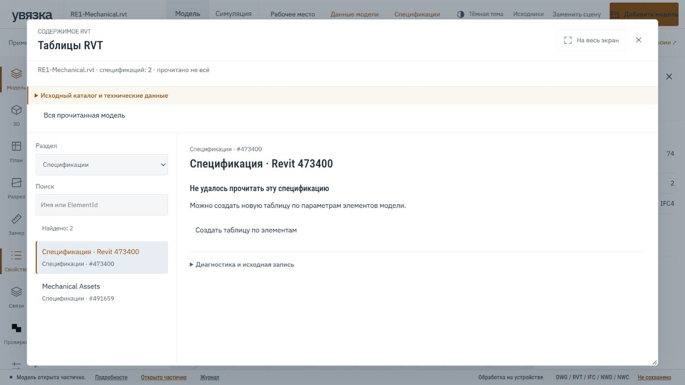

# Понятный язык интерфейса

Обычное окно показывает результат, значимое ограничение и доступное действие.
Внутренние классы, графы, смещения, хеши, коды ошибок и исходный JSON доступны
в свёрнутой диагностике. Это правило относится к загрузке, журналу, дереву,
карточкам свойств, исходным таблицам и сообщениям операций.
Панель проекта и вьювер используют одну функцию представления ошибок.
Сообщения чтения документов, приёма, поиска и обмеров сохраняют исходную
ошибку в закрытой диагностике. Перевод подписи не исправляет сам источник.

## Что остаётся на виду

- Названия оборудования, инженерные параметры, единицы и фактические значения.
- Копируемые Revit ElementId / UniqueId и IFC GlobalId.
- Источник значения, статус неполного чтения, отсутствие подтверждения.
- Фильтры спецификаций, влияющие на состав таблицы, и вопросы к её значениям.

Служебные поля скрываются только по известным признакам сериализатора.
Произвольный параметр проекта не считается служебным из-за английского названия.
Исходные данные, идентификаторы сцены, выгрузки и доступ модели через MCP
не меняются при переводе подписи интерфейса.
Названия стандартных категорий переводятся для показа; кнопка копирования
сохраняет исходное значение. В таблицах исходные обозначения остаются в
CSV/JSON и данных ячейки. При вводе полной переведённой категории условие
привязывается к её единственному исходному значению; неоднозначность требует
уточнения и не создаёт правило молча. Операторы правил остаются прежними.
Хеши шаблонов заменены понятной отметкой другой модели/версии; исходная
привязка сохраняется и проверяется при открытии.

## Непрочитанная спецификация

Если запись таблицы не прочитана, окно сообщает об этом и предлагает создать
новую таблицу по параметрам элементов. Оно не показывает фиктивную пустую
таблицу, нулевые итоги или успешное восстановление исходной спецификации.
Новая таблица требует самостоятельной настройки состава и фильтров.

Исходная ошибка остаётся в разделе «Диагностика и исходная запись».
Исправление сообщения не устраняет ограничение читателя RVT.

## Проверки

Регрессионные проверки используют синтетические записи: понятное сообщение,
точное сохранение диагностики, копируемые параметры, отсутствие ложной пустой
таблицы и безопасное отображение текста. Полный веб-набор: 232 теста.
В браузере для иллюстрации используется открытый пример RE1-Mechanical.rvt
из репозитория Drshelden (MIT; атрибуция в демо).

