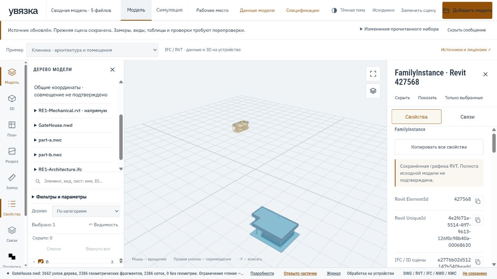

# Проверка сцены RVT + NWD + NWC + IFC



Проверка 29.10.2026 разделяет реальные адаптеры, сборку сцены и действия
в браузере. Открытие файлов не подтверждает инженерное совмещение или полноту
их содержимого. Публичный сценарий использует открытые и синтетические данные.

## Воспроизводимый состав

- RE1 Mechanical RVT и RE1 Architecture IFC из открытого MIT-корпуса
  [IFC-ECS](https://github.com/Drshelden/IFC-ECS/tree/9e8b37175a0fba1397f7011aeee917fe52de7623/data/RE1).
  SHA-256 проверяются по [манифесту](../tools/browser-fixtures.json).
- GateHouse.nwd из [Autodesk-Forge/models.autodesk.io](https://github.com/Autodesk-Forge/models.autodesk.io),
  MIT. SHA-256: `ede85d6fa175184b4e6de6b08b3f7be093bdfa4daa66576702958fb97fd96d79`.
- Два независимо созданных искусственных NWC с разными пространствами имён.
  Они проверяют очередь и сборку сцены; совместимость произвольного экспорта
  Navisworks по ним не устанавливается.

После подготовки runtime веб-демо и загрузки RE1 поместите GateHouse.nwd из
`samples/GateHouse.nwd` указанного репозитория в
`.uvyazka-build/nwd-research/samples/`. Тест проверит SHA-256 до чтения.

```powershell
python tools/build_nwd_recovery_fixture.py .uvyazka-build/mixed-scene/part-a.nwc --namespace scene_nwc_a
python tools/build_nwd_recovery_fixture.py .uvyazka-build/mixed-scene/part-b.nwc --namespace scene_nwc_b
node --experimental-strip-types tools/check_mixed_scene.mjs .uvyazka-build/mixed-scene
```

Нужны Node с `--experimental-strip-types`, зависимости `web` и runtime в
`.uvyazka-build/public-site/uvyazka/runtime`. Скрипт использует настоящий RVT WASM,
NWD WASM и web-ifc. Renderer в этом тесте не запускается; отрисовка проверяется
отдельно в браузере.

## Проверка адаптеров и архива

Пять источников успешно собраны в один производный пакет. Проверены:

- уникальность составных ID, исходные ID и Revit-идентификаторы;
- пространства имён дерева, 5075 отношений и прочитанных систем;
- 5088 образцов координат после размещения; одному синтетическому источнику
  заданы перенос и поворот, допуск вычислительной проверки — 0,1 мм;
- неизменность исходных пакетов и бинарной геометрии;
- упаковка и обратное чтение `.uvz`, состав, размещения, выбор и скрытый источник.

Метры для искусственных NWC заданы автором генератора. Неизвестные единицы
запрашиваются отдельно для каждого файла и записываются как допущение.
Соответствие координат вычисленной формуле не доказывает совмещение разных
зданий или корректность проектных общих координат.

## Проверка интерфейса

В локальном браузере с CSP публичного демо выполнены открытие пяти источников,
поиск по Revit ID, выбор элемента, копируемые свойства и скрытие источника.
Снимок восстановлен после перезагрузки. Архив скачан через интерфейс и этот же
файл импортирован обратно: состав, выбор и скрытие сохранились.

Подготовленный архив остаётся доступен ссылкой, если автоматическое скачивание
не началось. Ошибки подготовки видны внутри окна рабочего места. Исходные
RVT/NWD/NWC/IFC в `.uvz` не включаются; сохраняются прочитанные данные.

## Изменения NWD/NWC

Декодер поддерживает длинные повторы слотов индексов `0x80..0xdf`. Это не
эвристическое достраивание поверхности: сохраняются проверки числа координат,
границ записи, числа примитивов, раскладки полос и локального габарита.
Синтетические регрессии проверяют диапазон кодов, независимую полосу с `0x8e`,
переполнение и отсутствие начального индекса. Нарушение границ не создаёт граней.

Ревизия `index-runs-v4-20261029` передаётся из WASM и проверяется адаптером.
JS и WASM запрашиваются с одной версией; несоответствие даёт понятную ошибку.
Производный ID включает версию читателя. Явное «Обновить источник» разрешает
заново прочитать те же байты, обычное добавление продолжает отсекать дубликаты.
В истории сохраняются прежний и новый ID пакета и версии импортёра.
Скрытый целиком источник остаётся скрытым и после обновления читателя, включая
новые прочитанные элементы. Это правило видимости, а не сопоставление объектов:
выбор и индивидуальные настройки всё ещё требуют однозначных исходных ID.

Проверки реализации: **213 веб-тестов**, TypeScript без ошибок, **43 Rust-теста**
читателя и успешная WASM-сборка. Это не поддержка всех вариантов Navisworks.
[Неподдержанные структуры и охват](NWD.md) сохраняются явно. Полнота RVT
проверяется [отдельным сравнением с авторскими IFC](RVT_REFERENCE_AUDIT.md).
