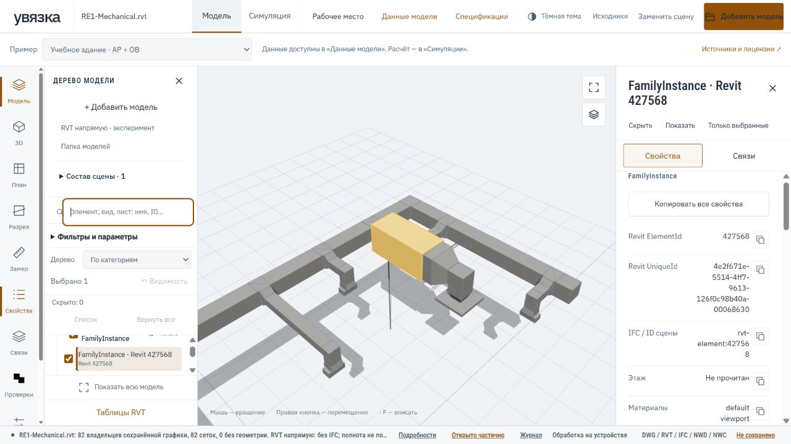

# RVT напрямую — экспериментальный режим

Режим добавлен 29 октября 2026 года. По умолчанию остаётся маршрут RVT → IFC.

## Как открыть

В дереве модели нажмите **RVT напрямую · эксперимент** и выберите `.rvt`.
Команда открывает новую сцену. Для добавления к существующей сцене выберите
в параметрах файла **Режим чтения RVT → Напрямую · экспериментальный**, затем
используйте обычную кнопку добавления модели. Для возврата к прежнему читателю
выберите **Через IFC · текущий режим**.

Один файл можно открыть обоими способами для сравнения: пакеты имеют разные ID,
но сохраняют SHA-256 одного оригинала. Повторное добавление в том же режиме
пропускается. Сравнивайте источники по отдельности, чтобы наложенные поверхности
не воспринимались как ошибка модели. Автоматического переключения на IFC нет.

Повторное открытие использует локальный кеш прочитанной модели и каталога,
если совпадают исходный файл, режим и версия обработчика. Частичный результат
остаётся частичным. При недоступном кеше читается оригинал; «Обновить источник»
сохраняет режим выбранного источника. [Критерии доводки и проверки](RVT_VIEWER_QUALITY.md).

## Что делает код

`rvt-rs native_saved_scene` читает поддержанные сохранённые поверхности RVT,
размещения общей графики и материалы. Наш мост переводит координаты из футов
в метры, сохраняет начало координат и упаковывает вершины / индексы в бинарный
буфер. JavaScript получает `Uint8Array` и метаданные; IFC-сущности и STEP-файл
в этом маршруте не создаются, движок web-ifc не запускается.

ElementId передаётся строкой, UniqueId берётся из исходной таблицы идентичностей.
Параметры и их определения, адреса записей, источники материалов и общих графов
сохраняются как прочитанные данные. Каталог видов / таблиц и поддержанные
инженерные системы читаются теми же отдельными нативными маршрутами, что раньше.
Наличие записи вида не означает наличие его изображения.

## Ограничения

- Это профиль сохранённой графики, а не полноценное выполнение Revit.
  Пригодная поверхность может отсутствовать, хотя элемент есть в исходнике.
- В 3D-дерево входят владельцы пригодных поверхностей. Служебные записи, типы
  и другие записи без поверхности учитываются отдельно в диагностике.
  Их число не является числом пропущенных строительных элементов.
- Владелец графики не подтверждает отдельный физический экземпляр. Автоматический
  подсчёт оборудования по форме ГОСТ и строительная симуляция для таких строк
  запрещены. Числовые параметры остаются сохранёнными значениями с исходными
  единицами; они не становятся расчётными объёмами геометрии.
- Уровни, стадии, варианты, видимость исходного вида, текстуры и связанные модели
  этим режимом полностью не воспроизводятся. Непрочитанное не заменяется нулём.
- Бюджет выходной геометрии — 512 MiB; это не лимит всей памяти вкладки.
  Разбор родного контейнера имеет свои ограничения; файл 2 GiB не гарантированно
  откроется. Ошибка сохраняет прежнюю сцену и доступную диагностику.

## Проверка

Десять Rust-тестов моста: среди них точный ID выше 2^53, координаты в метрах,
бинарные диапазоны, повреждённая топология, бюджет, пустой результат и отделение
неотображаемых записей от владельцев поверхностей. Типы и ресурсы общей графики исключаются по явно прочитанной иерархии классов; совпадение имени не используется. Веб-набор: 196 тестов,
включая прямой адаптер, идентичность режимов, параметры, отказ от физических
количеств, повреждённые буферы и команду отдельного открытия.

WASM проверен на открытых RE1-Mechanical и RE1-Architecture (Drshelden, MIT).
Прежний экспорт IFC на RE1-Mechanical сохранён. Браузерная проверка использует
открытую модель; это не подтверждение поддержки произвольного RVT или версии.

