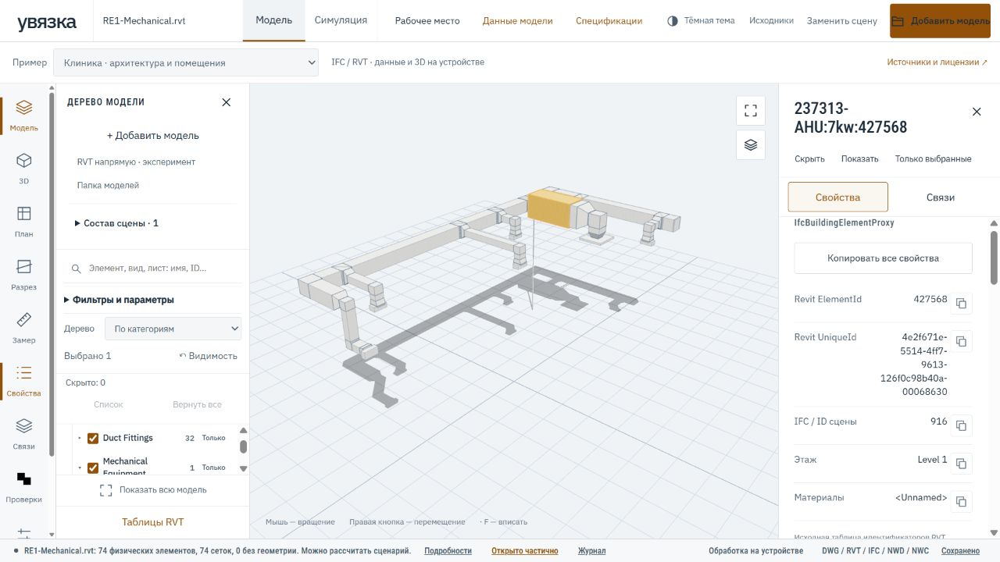

# Доводка открытия и просмотра RVT

Приоритет на 29 октября 2026 года — надёжное чтение и просмотр. Редактирование
родного RVT и экспорт изменённого RVT отложены. Существующий экспериментальный
читатель не становится полноценным движком Revit от наличия кнопки открытия.

## Что считаем хорошим результатом

Инженер выбирает файл, понимает текущую операцию, получает доступную модель,
находит элемент по исходному ID и проверяет его свойства. Если часть данных
не прочитана, интерфейс показывает ограничение. Ошибка нового файла сохраняет
предыдущую рабочую сцену. Повторное открытие не требует того же полного разбора.

Готовность проверяем по операциям, а не по одному общему «RVT поддерживается»:

| Область | Критерий приёмки |
|---|---|
| Открытие | Проверка непустого файла и технических бюджетов; текущий этап, время, отмена и итог; ошибка не выдаётся за пустую модель |
| Режимы | Прямое чтение и маршрут через IFC явно различаются; никакого скрытого перехода; обновление источника сохраняет его режим |
| Геометрия | Положение, поворот, масштаб, отражения, экземпляры общей графики и материалы проверяются на эталонных элементах; пропуски не скрываются |
| Координаты | Внутренние координаты и размещение в сводной сцене различаются; футы, метры и смещение начала не теряются |
| Дерево | Файл → доступные категории/уровни → элементы; точные ID, без округления больших чисел; служебные записи не считаются оборудованием |
| Навигация | Найти, выделить, приблизить, изолировать, скрыть, вернуть после снятия выделения; разрез и поиск не уничтожают исходные данные |
| Свойства | ElementId/UniqueId копируются; параметры экземпляра и типа различаются; исходные единицы и неизвестные значения сохраняются |
| Системы | Подсветка прочитанных участников с переходом к элементам; принадлежность системе не выдаётся за доказанную физическую связность |
| Виды и таблицы | Отдельная полнота каталога, графики видов и спецификаций; фильтры и неизвестные условия явно отражаются; список имён не выдаётся за готовые чертежи |
| Большие модели | Отмена прерывает worker; бюджет и остановка диагностируются; производительность измеряется отдельно для чтения, сцены и поиска |
| Повторная работа | Кеш не смешивает файлы/режимы/версии; рабочее место и проектная база сохраняют собственную историю и происхождение |

Это критерии дальнейшей проверки, а не заявление, что все они уже выполнены
для любых версий и любых RVT. Особенно требуют независимой проверки координаты,
связанные модели, отражённые экземпляры, стадии и графика исходных видов.

## Реализованный проход стабилизации

- Этапы прямого чтения RVT отделены от IFC. Дополнительные операции, например
  восстановление кеша и сохранение в проект, появляются в списке этапов.
  Не выполнявшиеся операции после окончания помечаются пропущенными.
- Режим фиксируется для всей очереди. Изменение переключателя во время обработки
  не меняет режим следующих файлов уже запущенного пакета.
- «Обновить источник» использует режим самого источника, в том числе после
  восстановления рабочего места, а не текущее значение общего переключателя.
- Неполный каталог RVT, пропуски параметров, ошибки сохранённых сеток и
  зарегистрированные пропуски геометрии учитываются в итоговом статусе.
  Отрисованная сцена не означает полного чтения документа.
- Для обоих маршрутов RVT введён кеш производных пакетов: модель, бинарная
  геометрия, прочитанный каталог, диагностика и промежуточный IFC, если он был
  получен. Кнопка скачивания IFC доступна и после восстановления из кеша.
- Проверка внешней сигнатуры отсекает заведомо другой/усечённый файл до загрузки
  WASM. Наличие сигнатуры CFB само по себе не подтверждает корректность RVT.
- При неудачном открытии и отмене сохраняется скачивание IFC прежней сцены.
- В маршрут через IFC добавлен родной UniqueId из уже прочитанного каталога
  параметров. Связь требует совпадения исходного SHA-256 и точного текущего
  ElementId, одного элемента сцены и одной нативной записи. Несовпадения,
  дубли и небезопасные числовые ID не подставляются. Существующий противоречивый
  UniqueId сохраняется с диагностикой. Источник соответствия остаётся в данных
  элемента; геометрические количества и стадии от этого не меняются.

### Кеш и память проекта

Ключ кеша включает SHA-256 исходного RVT, режим чтения и версию интерпретации.
Изменение читателя, локальных патчей или формата его результата требует смены
`RVT_CACHE_REVISION`. Проверяются источник, режим, обработчик, принадлежность
каталога и диапазоны бинарного пакета. Ошибка проверки, IndexedDB или квоты
приводит к чтению оригинала; невозможность записать кеш не отменяет модель.

Хранятся три последних использованных пакета. Для вытеснения читается небольшой
список времени доступа, а не геометрия всех записей. Оригинальные RVT в этот
кеш не попадают. Большой производный пакет может не поместиться в квоту браузера.

Кеш — ускорение повторного чтения на данном origin. Он не заменяет SQLite,
проектную память MCP, сохранённое рабочее место или архив `.uvz`. Очистка кеша
моделей не удаляет рабочие места и инженерные решения. Каталог RVT также имеет
отдельный кеш; при очистке геометрии он может использоваться повторно.

## Выполненные проверки этого прохода

TypeScript проверен без ошибок. Веб-набор: **205 тестов**, все прошли. Среди
регрессий: разделение режимов, неправильный источник/каталог, повреждённые
диапазоны кеша, сохранение промежуточного IFC, вытеснение по времени доступа,
фиксированный режим очереди, явный режим обновления источника, неполные
метаданные, точные/неоднозначные нативные ID и завершение этапов после восстановления кеша.

В настоящем браузере использованы открытые RVT
[RE1 из IFC-ECS](https://github.com/Drshelden/IFC-ECS/tree/9e8b37175a0fba1397f7011aeee917fe52de7623/data/RE1).
Это открытые примеры; результаты частных проектов в этот документ не включены.

| Проверка | Наблюдение |
|---|---|
| Прямое чтение RE1 Mechanical | Получена отображаемая сохранённая графика и доступные данные |
| Пакет RE1 Architecture + Electrical + Plumbing | Все три файла добавлены в общую сцену; ограничения чтения отмечены |
| Повторное прямое открытие Mechanical | Восстановление из кеша; этапы декодера пропущены; статус частичного чтения сохранён |
| Mechanical через IFC | Получена модель через прежний маршрут; кеш прямого режима не использован |
| Повторное открытие Mechanical через IFC | Модель восстановлена из отдельного кеша этого маршрута |
| Повреждённый синтетический RVT | Прежняя отображаемая модель сохранена; ошибка нового файла показана отдельно |
| Отмена обработки увеличенного синтетического образца | Обработка прервана на этапе конверсии; прежняя сцена и её IFC доступны |
| ElementId и UniqueId Mechanical | Элемент найден по исходному ID, родной UniqueId показан и скопирован |
| Скрытие и возврат | После снятия выделения в 3D элемент возвращён через «Вернуть все» |

Эти проверки подтверждают выполнение конкретных операций, но не совпадение
всей геометрии с Revit. Полноту нельзя оценить только отсутствием исключений.
Синтетические регрессии отдельно проверяют сохранение сцены при неудачной
подготовке и отрисовке; браузерные проверки дополняют, а не заменяют их.

## Следующий этап проверки читателя

Первый независимый прогон уже выполнен: [RVT против авторских IFC RE1](RVT_REFERENCE_AUDIT.md).
Различия формы и отсутствующие пары зафиксированы, их причины ещё требуют разбора.
[Смешанная сцена четырёх форматов](MIXED_SCENE_VALIDATION.md) проверена отдельно.

1. Зафиксировать эталонные элементы открытых моделей: ID, категория, тип,
   уровень, размещение, габариты и контрольные параметры. Сопоставить результат
   с независимым экспортом/просмотром, сохраняя происхождение эталона.
2. Проверить прямой и IFC-маршруты по этим элементам: потерянные экземпляры,
   искажения, отражения, двойная геометрия, материалы и единицы. Числа владельцев
   графики и физических элементов напрямую не сравнивать.
3. Составить матрицу версий и конструкций RVT. Отдельно отмечать метаданные,
   геометрию, системы, виды и таблицы. Не распространять результат одного файла
   на весь год выпуска Revit.
4. Исправлять найденные ошибки с минимальным синтетическим примером либо
   открытым лицензированным образцом. Затем повторять связанную регрессию
   и браузерную проверку, сохраняя рабочий маршрут по умолчанию.

[Прямое чтение](RVT_DIRECT.md) · [Данные RVT](RVT_DATA.md) ·
[Сохранение рабочего места](VIEWER_WORKSPACE.md)
