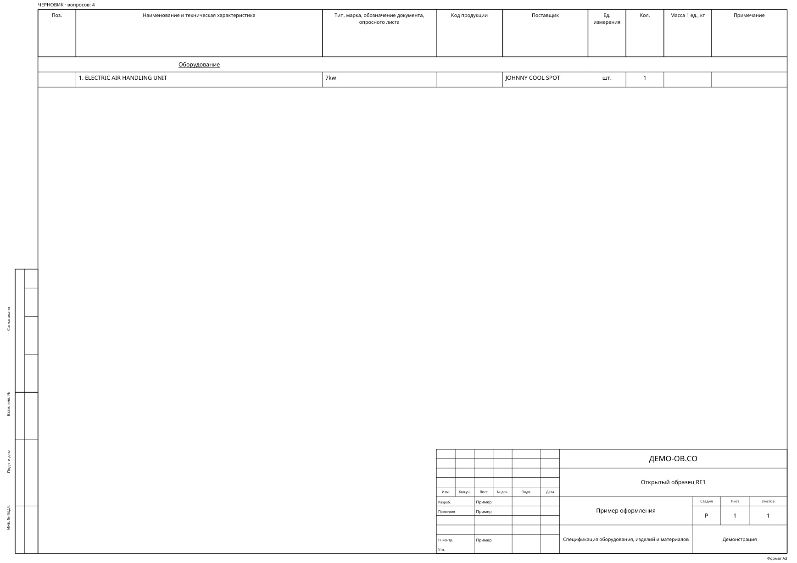
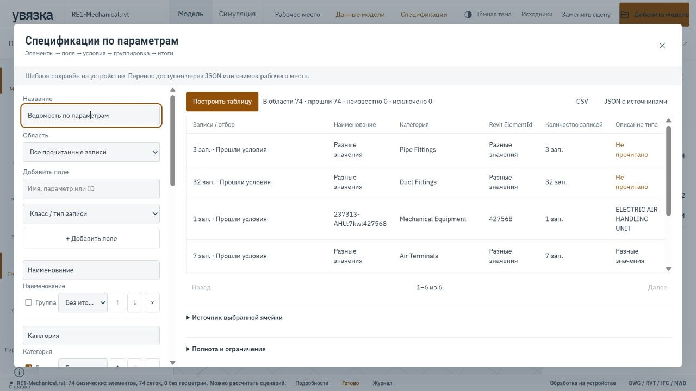
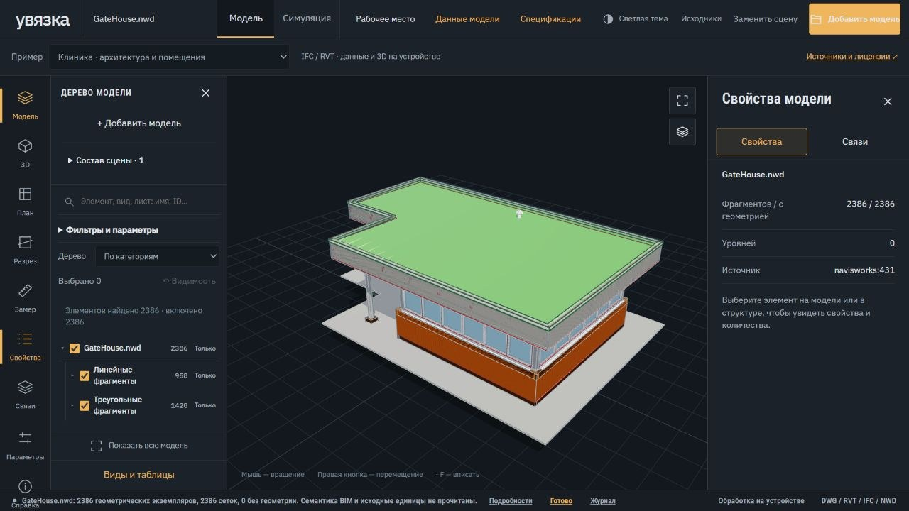
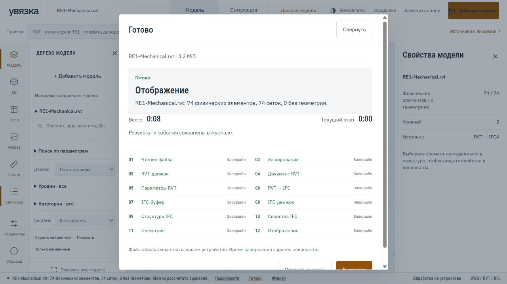
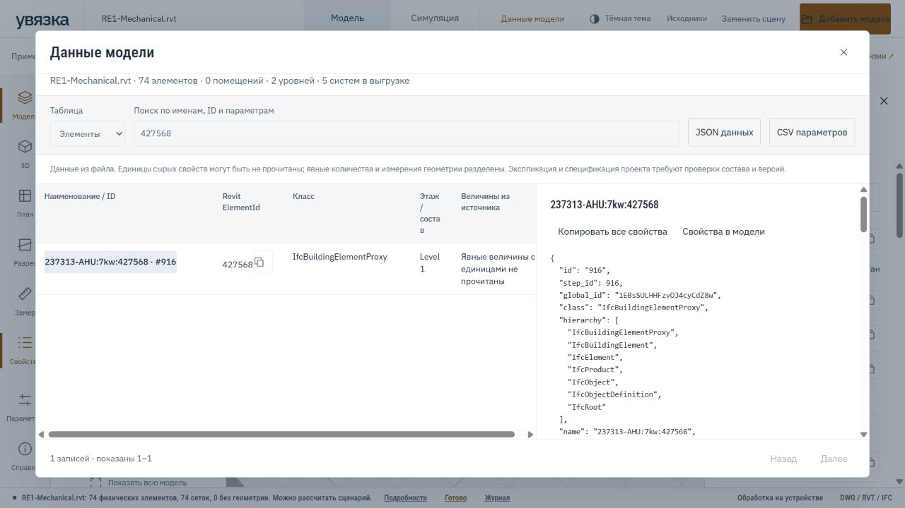

# Скриншоты Увязки

## Спецификации по ГОСТ — alpha.14

Локальная браузерная проверка сборки alpha.14 на открытом RVT, 27 октября 2026.

RE1-Mechanical, Drshelden, MIT. Исходные параметры показаны без изменения;
реквизиты «ДЕМО-ОВ.СО», организация и проверяющие — вымышленные примеры.
Четыре незаданные графы сохраняют статус черновика. Подписи и даты не проставлены.
Это созданная Увязкой спецификация, а не восстановленный лист Revit.
[Источники и условия](DEPENDENCIES.md#демонстрационные-материалы) ·
[Как создать спецификацию](GOST_SPECIFICATIONS.md).

## Новые функции — alpha.13

Локальная браузерная проверка на открытых моделях, 26 октября 2026.

RE1-Mechanical, Drshelden, MIT. Таблица создана конструктором Увязки;
она не воспроизводит исходные формулы и оформление спецификаций Revit.

GateHouse.nwd, Autodesk-Forge/models.autodesk.io, MIT.
[Открытый исходный образец](https://github.com/Autodesk-Forge/models.autodesk.io/blob/master/samples/GateHouse.nwd).
Масштаб на снимке задан вручную как метры; единицы файла пока не расшифрованы.
Фрагменты геометрии не считаются оборудованием. Полная поддержка NWD не заявлена.

[Конструктор таблиц](PARAMETER_SPECIFICATIONS.md) · [Ограничения NWD](NWD.md).

## Веб-вьювер — 26 октября 2026

Снимки работающего [публичного демо](https://locia.work/uvyazka/), версия
0.3.0 alpha 12. Пользовательские IFC/RVT обрабатываются в браузере;
DWG/DXF открываются в отдельном CAD-вьювере со слоями.

### Сводная модель АР + ОВ + ЭОМ

Сводная сцена открытого образца клиники. Разделы совмещены по исходным
координатам; это не результат проверки коллизий. Уровни и помещения разных
разделов автоматически не объединяются.

### RVT и свойства элемента

Исходный RE1-Mechanical.rvt прочитан без Revit через браузерный декодер.
В карточке показан сохранённый ElementId; непрочитанный UniqueId явно
обозначен. Членство в системе не доказывает физическое подключение.

### Этапы обработки RVT

Окно обработки показывает этап, прошедшее время и доступ к журналу.
Время на снимке относится только к этому запуску. Успешное отображение
не подтверждает полноту извлечения: оформление листов и все вычисляемые
строки спецификаций не восстанавливаются.

### Поиск и данные модели

Таблицы элементов, помещений, уровней и прочитанных систем; поиск по именам,
ID и параметрам, копирование и экспорт JSON/CSV. Отсутствующие значения
не заменяются нулями.

Источники моделей: **BSI (2020) Medical-Dental Test Files**, buildingSMART
International, CC BY 4.0; **RE1-Mechanical**, Copyright (c) 2026 Drshelden, MIT.
На снимках изменены ракурс и выделение; клиника представлена федерацией
триангулированных IFC, RVT — результатом экспериментального чтения.
[Ссылки, лицензии и преобразования](DEPENDENCIES.md#демонстрационные-материалы) ·
[Покрытие и ограничения демо](PUBLIC_DEMO.md).

## Измерения по видам — alpha.11

Снято 20.10.2026 на синтетическом листе. Для проверки истории контрольный
размер второго вида намеренно изменён с 0,5 до 1 м: площадь меняется
с 0,25 до 1 м² после явного пересчёта. Это испытание механизма ревизий,
а не исправление реального проекта.

[Работа с измерениями](MEASUREMENTS.md).

## Ранние экраны локальной панели

Следующие скриншоты работающих версий 0.1 и 0.2 alpha сняты 15.10.2026.
Данные двух учебных объектов синтетические. Они демонстрируют интерфейс,
источники и арифметические сопоставления; это не результаты аудита здания.

## Показатели и основания

Сохранённые наблюдения, единицы, область измерения и переход к источнику.
В примере площадь совпадает, а объём бетона в двух документах различается.

## Совпадения и вопросы

Результаты сопоставлений видны вместе с основаниями и связанными наблюдениями.
Совпадение не означает инженерного принятия значения.

## Происхождение числа

Карточка показывает наблюдение, ревизию, исходный файл, адрес строки и текст.

## Несколько проектов

Объекты имеют отдельные базы. В панели можно выбрать текущий объект
или перейти через общий реестр.

## Обзор объекта

Состав источников, сохранённые наблюдения, вопросы и покрытие извлечения.

[Запустить свою панель](INSTALLATION.md) · [Вернуться к README](../README.md)

## График и моделирование

Синтетическая модель из шести коробок. Базовый вариант — 600 минут,
вариант с двумя бригадами и кранами — 510. Все длительности условные.

## Увязка разделов

Десять вымышленных насосов, три подключения, семь пропусков;
экспликации АР/ОВ различаются, часть разделов ещё не рассмотрена.

## Загрузка RVT без агента

Экран действующей локальной панели на синтетическом проекте, без загруженной
реальной модели. После выбора файла приложение самостоятельно запускает чтение
и конверсию; необязательный условный сценарий доступен в том же процессе.
Это снимок ранней локальной панели. Текущее публичное демо принимает IFC/RVT
и открывает DWG/DXF в отдельном CAD-вьювере; файлы обрабатываются в браузере.

## Геометрические проверки — 0.4.0-alpha.1

Синтетический стенд с заранее заданными пересечениями и зазором. Пара элементов,
история решения, сохранённый вид и экспорт BCF/XLSX. Ни один элемент не взят
из частного проекта.

## Настольная Увязка — 0.4.0-alpha.1

Windows-приложение после проверенной установки обновления. Учебный объект
и все показатели вымышлены.

