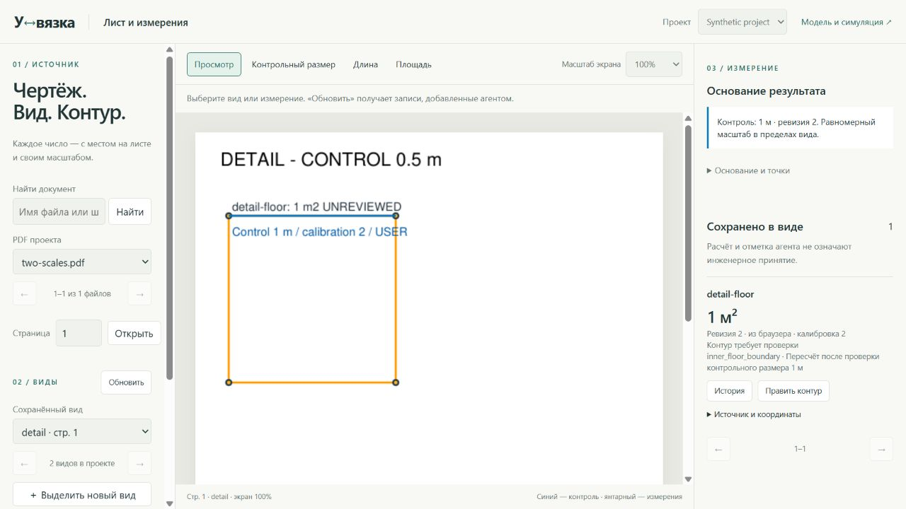
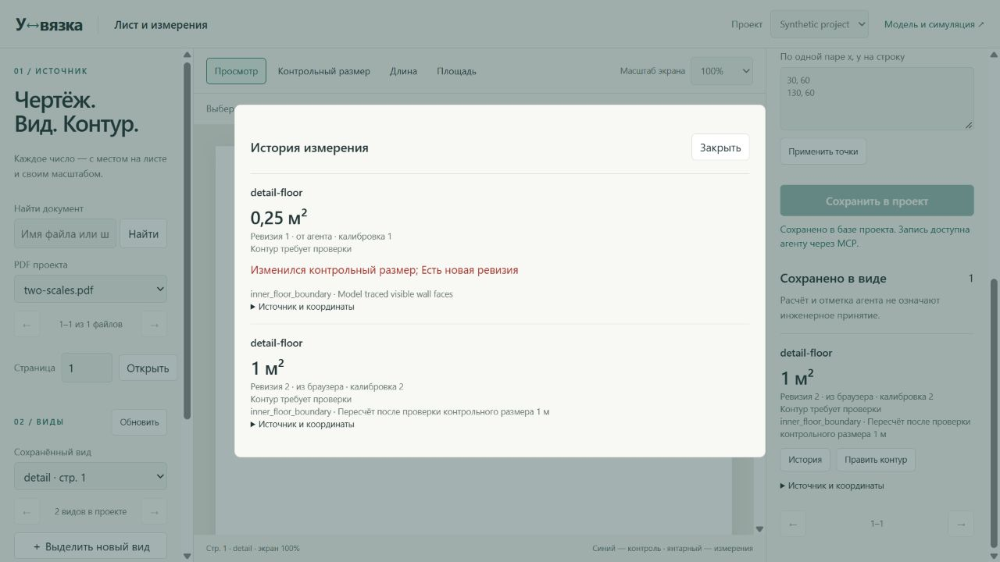
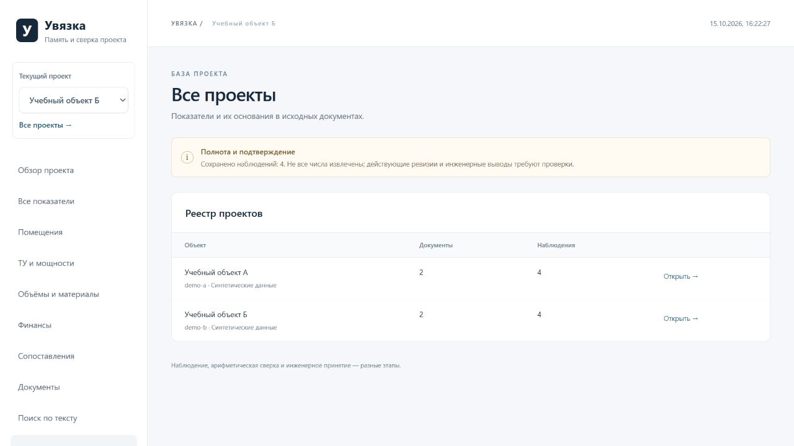
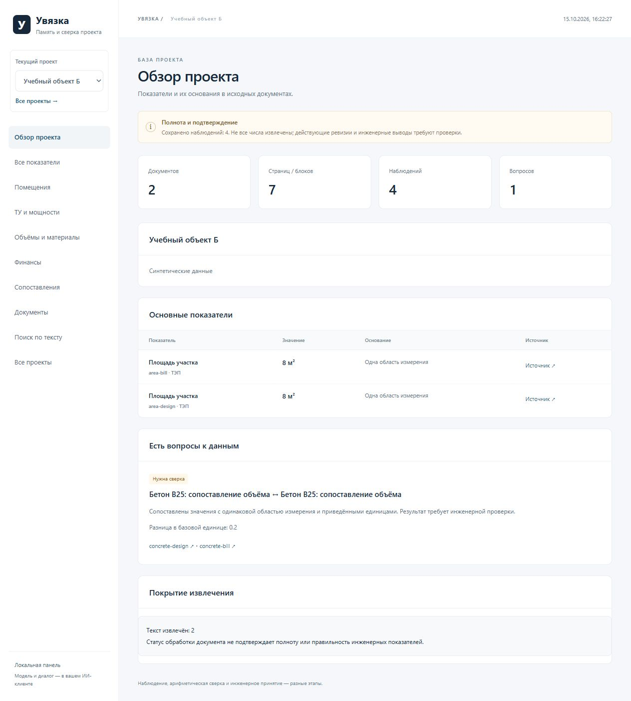
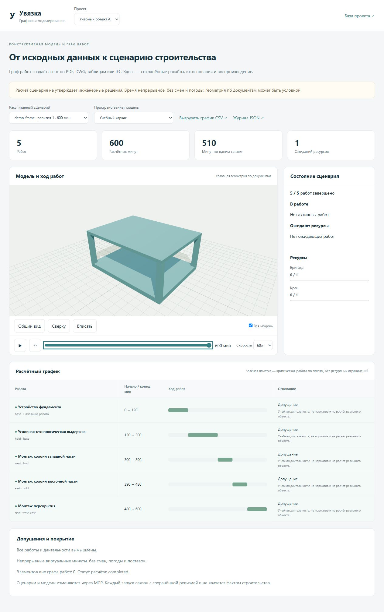
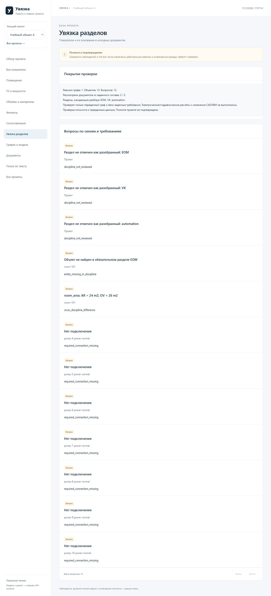

# Панель Увязки

## Измерения по видам — alpha.11

Снято 20.10.2026 на синтетическом листе. Для проверки истории контрольный
размер второго вида намеренно изменён с 0,5 до 1 м: площадь меняется
с 0,25 до 1 м² после явного пересчёта. Это испытание механизма ревизий,
а не исправление реального проекта.

[Работа с измерениями](MEASUREMENTS.md).

Скриншоты работающих версий 0.1 и 0.2 alpha, снятые 15.10.2026.
Данные двух учебных объектов синтетические. Они демонстрируют интерфейс,
источники и арифметические сопоставления; это не результаты аудита здания.

## Показатели и основания

Сохранённые наблюдения, единицы, область измерения и переход к источнику.
В примере площадь совпадает, а объём бетона в двух документах различается.

## Совпадения и вопросы

Результаты сопоставлений видны вместе с основаниями и связанными наблюдениями.
Совпадение не означает инженерного принятия значения.

## Происхождение числа

Карточка показывает наблюдение, ревизию, исходный файл, адрес строки и текст.

## Несколько проектов

Объекты имеют отдельные базы. В панели можно выбрать текущий объект
или перейти через общий реестр.

## Обзор объекта

Состав источников, сохранённые наблюдения, вопросы и покрытие извлечения.

[Запустить свою панель](INSTALLATION.md) · [Вернуться к README](../README.md)

## График и моделирование

Синтетическая модель из шести коробок. Базовый вариант — 600 минут,
вариант с двумя бригадами и кранами — 510. Все длительности условные.

## Увязка разделов

Десять вымышленных насосов, три подключения, семь пропусков;
экспликации АР/ОВ различаются, часть разделов ещё не рассмотрена.

## Загрузка RVT без агента

Экран действующей локальной панели на синтетическом проекте, без загруженной
реальной модели. После выбора файла приложение самостоятельно запускает чтение
и конверсию; необязательный условный сценарий доступен в том же процессе.
Это снимок ранней локальной панели. Текущее публичное демо принимает IFC/RVT
и открывает DWG/DXF в отдельном CAD-вьювере; файлы обрабатываются в браузере.
