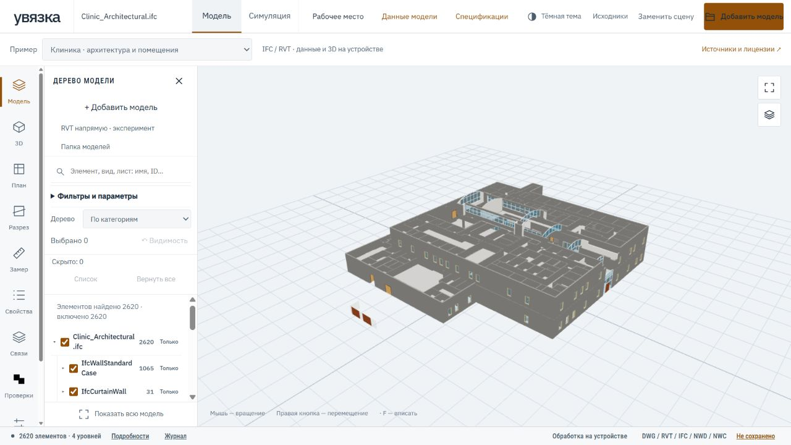

# Диагностика отзывчивости вьювера

На скриншоте — открытая Medical-Dental Clinic. [Источник и лицензии демо](PUBLIC_DEMO.md).

Для локального воспроизведения добавьте `diagnostics=performance` к URL вьювера.
Например: `/uvyazka/?project=demo-a&diagnostics=performance`.
В консоли браузера появятся строки `uvyazka-performance`. Диагностика выключена
по умолчанию, не делает сетевых запросов и ограничена двадцатью образцами
каждой операции за загрузку страницы.

- `render`: время вызова Three.js renderer, число команд отрисовки, треугольников,
  линий, геометрий и объектов; состояние теней.
- `viewer-load`: построение объектов представления после получения пакета.
- `filter-and-tree`: фильтрация и перестроение дерева.
- `visibility-and-tree`: вся операция обновления дерева, видимости и подсветки.
  Включает предыдущую операцию; их длительности нельзя складывать.
- `pick`: время точного выбора, число объектов, кандидатов и проверенных сеток.
- `presentation`: обновление видимости, материала и выделения; число затронутых элементов.
- `graphics-device`: драйвер и поставщик WebGL, если браузер разрешает их
  прочитать. Программная растеризация (например WARP или SwiftShader) требует
  отдельной отметки: её результат нельзя выдавать за скорость аппаратной GPU.

Это измерения времени в основном потоке браузера, а не отдельный GPU timer.
Первый кадр включает подготовку шейдеров и загрузку ресурсов: измеряйте также
повторные кадры при перемещении камеры. Эти записи сами по себе не измеряют FPS
непрерывного движения и не являются оценкой совместимости формата.

Имена файлов и свойства не логируются. Количества и размеры, полученные
на частной модели, также могут раскрывать проект: не публикуйте такие логи.
Для публичных регрессий используйте искусственные или открытые модели.

## Пакетная отрисовка и границы ускорения

Для моделей более 2000 сеток поверхности рисуются через `THREE.BatchedMesh`.
Непрозрачные и прозрачные материалы разделены; цвет и alpha сохраняются для
каждой части. Буферы разбиваются на части до 2048 групп, 500 тысяч вершин или
1,5 миллиона индексов. Одна большая геометрия остаётся целой, а не отбрасывается
по этому порогу. Исходные линейные сегменты собираются отдельно в общие буферы
с цветом и видимостью; связность инженерных систем из них не выводится.

Исходные сетки, индексы граней, ID, количества и параметры остаются без изменений.
Выбор и замер используют оригинальные сетки с тем же переходом координат;
изменения в GPU-буферах не сохраняются как изменения BIM-модели. Выбранные и
подсвеченные элементы временно рисуются отдельно, сохраняя прежний вид выделения.
Скрытие работает по исходным ID. Разрез применяется к поверхностям, линиям и
выделению. Прозрачность восстанавливается и из сохранённого вида.

Симуляция возвращается к индивидуальным сеткам, чтобы сохранить поведение
грузов, стадий и техники. Это ускорение обычного просмотра, не обещание скорости
каждого режима. Много одновременно подсвеченных элементов увеличивает число
вызовов отрисовки. Без `WEBGL_multi_draw` Three.js использует последовательные
вызовы для поверхностей; ускорение зависит от возможностей браузера.

У крупных моделей отключены вычисляемые декоративные контуры. Исходные линии
из файла сохраняются. Пакетные буферы требуют дополнительной памяти; это не
устранение ограничений браузера по размеру модели.

Структура NWD/NWC индексируется для неизменной ревизии. При том же наборе строк
дерево сохраняет реальные DOM-узлы, страницу и прокрутку: обновляются флажки,
состояние ветвей и выделение. Изменение запроса или состава модели перестраивает
нужный набор. Фильтрация кешируется по ревизии, запросу и условиям; значения
параметров, неизвестные величины и трактовка исходных данных от этого не меняются.

Контекст WebGL запрашивается с `powerPreference: high-performance`. Это подсказка
браузеру, а не гарантированное переключение на дискретную видеокарту. Фактический
адаптер следует смотреть в `graphics-device`; настройки Windows не меняются.

Для сопоставления в диагностическом режиме можно добавить `rendering=individual`:
будут использованы те же данные и прежние индивидуальные сетки. Сохраните и
восстановите одинаковые камеру, разрез, прозрачность и видимость, дождитесь
прогрева и сравните повторные кадры. Без `diagnostics=performance` этот параметр
не отключает штатное ускорение. Это локальный способ проверки, а не новая ревизия
проектной модели. Результат на частном проекте в публичную документацию не включается.

Регрессии проверяют исходные ID и грани при выборе, группы, цвета и alpha,
скрытие и возврат, разрезы, переключение симуляции, исходные линии, отсутствие
усечения по границе буферов, сохранение DOM и страницы дерева. Веб-набор:
**247 тестов**, TypeScript без ошибок. Браузерные прогоны дополнительно проверяют
реальную отрисовку; модульные тесты не измеряют GPU.

Проверять следует отдельно: декодирование, сборку сцены, первый кадр, повторные
кадры, выбор, поиск, скрытие и сохранение. Объём исходного файла сам по себе
не описывает нагрузку после распаковки и построения объектов.

## Выбор, поиск и сборка сцены

Пространственный индекс отбирает возможные сетки по их фактическим габаритам.
Пересечение по исходным треугольникам и линиям по-прежнему вычисляет Three.js:
сохраняются ID, номер грани и точка замера. Учитываются видимость, сечения,
ближняя и дальняя границы луча и допуск выбора линий. Индекс строится для
текущей неизменной сцены и освобождается при её замене.

При смене выделения или подсветки обновляются только затронутые элементы.
Глобальные режимы, включая прозрачность, обновляют всю сцену. Поиск по имени,
семейству и ID кеширует прочитанные общие группы свойств внутри ревизии;
новая ревизия получает отдельные записи. Это не поиск по всем значениям параметров:
для него предназначены условия фильтрации.

Сборка сцены вычисляет преобразование размещения один раз на источник,
сохраняя исходный порядок арифметики. Координаты и бинарная геометрия проверяются
регрессиями, включая повороты, смещения и большие мировые координаты.

Для локального сравнения выбора и обновления выделения добавьте
`diagnostics=performance&interactions=legacy`. Это включает прежний линейный
поиск пересечений и обновление всех материалов. Данные модели и пакетная
отрисовка остаются теми же. Без диагностического режима сравнение не включается.
